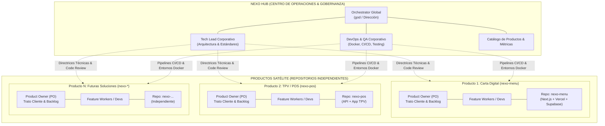
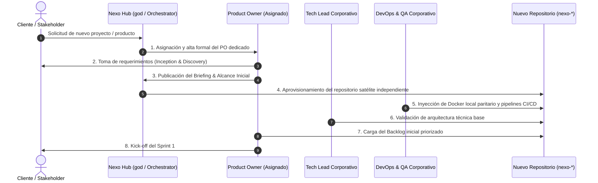

# NEXO PLATFORM — ARQUITECTURA MULTIPRODUCTO & GOBERNANZA OPERATIVA
**Documento Maestro de Arquitectura Organizacional y de Software (Modelo Consultoría / Software Factory)**  
*Fecha: Noviembre 2026 | Versión: 2.0.0 | Estado: Aprobado para Ejecución*

---

## 1. Visión Estratégica y Contexto

Nexo evoluciona desde un producto unitario (la aplicación de carta digital para hostelería) hacia un **ecosistema de consultoría y factoría de software (Software Factory)**. 

Bajo este modelo:
- **Nexo (Proyecto Central / Hub)** actúa como el **nexo conector, centro de operaciones y gobernanza transversal**: coordina la metodología, la orquestación del equipo de agentes, los estándares de calidad técnica (QA), la infraestructura base (DevOps) y la supervisión del ciclo de vida de todos los proyectos.
- **Cada Producto o Solución de Cliente** opera en un **repositorio independiente y desacoplado**, gestionado funcionalmente por un **Product Owner (PO) dedicado** que mantiene la interlocución directa con el cliente/stakeholder y lidera la visión y el backlog específico.



---

## 2. Topología de Arquitectura Multi-Repositorio (Multi-Repo)

### 2.1. Repositorio Central (`Nexo`) — The Core Hub
- **Propósito**: Gestión corporativa, templates, automatizaciones globales, orquestación Hive y panel de estado multi-proyecto.
- **Contenido del repositorio**:
  - `hive/`: Flota de agentes coordinadores, templates de roles, protocolos de comunicación e historial de tareas corporativas.
  - `docs/`: Documentación de arquitectura transversal, guías de gobernanza, políticas de seguridad y normativas (RGPD, Alérgenos UE, etc.).
  - `products/`: Registro y manifiestos de los productos activos, asignaciones de Product Owners, repositorios vinculados y hojas de ruta.
  - `templates/`: Blueprints y scaffolds base (Dockerfiles, configuraciones de GitHub Actions, plantillas de Next.js/Tailwind, scripts de QA base).
  - `monitoring/`: Paneles y scripts de auditoría de consumo (tokens IA, costes serverless, SLAs).

### 2.2. Repositorios Satélite (`nexo-<producto>`) — Dedicated Product Repos
- **Propósito**: Cada producto tecnológico cuenta con su propio repositorio Git bajo la organización, con total autonomía de dependencias, versiones y despliegue.
- **Características fundamentales**:
  - **Desacoplamiento total**: Cada producto posee su propio `package.json`, su propio Docker Compose y sus propios pipelines de CI/CD.
  - **Versionado Semántico Independiente**: Cada producto versiona (`v1.0.0`, `v1.1.0`...) según el ritmo de sus sprints y releases con el cliente.
  - **Aislamiento de credenciales y entornos**: Bases de datos, variables de entorno y buckets de almacenamiento segregados por cliente y producto.

---

## 3. Estructura del Equipo y Matriz de Responsabilidades (RACI)

La organización se divide en dos niveles claramente diferenciados: **Capa Transversal (Gobierno Técnico y Operativo)** y **Capa de Producto (Negocio y Entrega)**.

| Rol | Ubicación | Responsabilidad Principal | Interlocución con Cliente |
| :--- | :--- | :--- | :---: |
| **Orchestrator (`god`)** | Core Hub | Asignación estratégica de recursos, resolución de bloqueos y supervisión de la factoría. | No directa |
| **Tech Lead Corporativo (`nexo-tech-lead`)** | Core Hub | Arquitectura técnica común, aprobación de PRs críticas, contratos de API y seguridad. | Soporte técnico |
| **DevOps & QA Senior (`nexo-devops-qa`)** | Core Hub | Aprovisionamiento de pipelines CI/CD, paridad Docker local, testing automatizado y SLAs. | No |
| **Product Owner (`nexo-po-<producto>`)** | Por Producto | **Máximo responsable del producto ante el cliente.** Define la visión, prioriza el backlog, valida entregas y coordina los sprints. | **SÍ (Directa y Exclusiva)** |
| **Feature Engineers / Devs** | Por Producto | Construcción e implementación de las funcionalidades del producto asignado. | Ocasional (demos) |

### 3.1. Funciones Específicas del Product Owner (PO)
Por cada producto que se active, se asigna un Product Owner con las siguientes atribuciones:
1. **Punto Único de Contacto con el Cliente (SPOC)**: Recibe solicitudes, canaliza feedback, gestiona expectativas de entrega y acuerda prioridades de negocio.
2. **Propiedad y Gestión del Backlog**: Traduce las necesidades de negocio en *Epics*, *Historias de Usuario (User Stories)* y *Criterios de Aceptación (Acceptance Criteria)* verificables.
3. **Análisis Competitivo**: Investiga soluciones de referencia en el sector del producto para proponer innovaciones de alto valor diferencial.
4. **Criterio de Aceptación y "Definition of Done" (DoD)**: Comprueba que cada feature cumple los requisitos funcionales antes de dar su aprobación (*Sign-off*) para el pase a producción.
5. **Coordinación con el Core Técnico**: Trabaja en estrecha sincronía con el `Tech Lead` y `DevOps-QA` para estimaciones, dependencias técnicas y fechas de release.

---

## 4. Protocolo Estándar para el Alta de un Nuevo Producto

Cuando un nuevo cliente o línea de negocio solicita un producto a la factoría Nexo, se ejecuta el siguiente protocolo estandarizado de 5 fases:



### Detalle de Fases:
- **Fase 1: Asignación y Alta del Product Owner**:
  - Se selecciona o da de alta el perfil de PO en la flota (ej. `nexo-po-menu` para hostelería, `nexo-po-pos`, etc.).
  - Se define la dedicación y los canales de comunicación con el cliente.
- **Fase 2: Creación del Repositorio Satélite**:
  - Creación del repositorio `https://github.com/JonyDevProjects/nexo-<nombre-producto>`.
  - Configuración de ramas base `main` (producción) y `develop` (integración continua).
- **Fase 3: Infraestructura DevOps & Testing**:
  - Clonado de plantillas base de Docker (`Dockerfile` multi-stage y `docker-compose.yml`).
  - Configuración de workflows de GitHub Actions para ejecución automática de `npm run test:ci` en cada Pull Request.
- **Fase 4: Ejecución Iterativa (Sprints)**:
  - Desarrollo de funcionalidades en ramas `feature/<nombre>`.
  - Toda PR requiere: 1) Aprobación técnica de `Tech Lead / DevOps-QA`, 2) Cobertura de tests al 100%, y 3) Validación funcional del PO.
- **Fase 5: Demo y Aceptación por el Cliente**:
  - El PO realiza la demostración de la versión candidata ante el cliente.
  - Firma del incremento y despliegue a producción.

---

## 5. Plan de Desacoplamiento de la Carta Digital (`nexo-menu`)

El código actual desarrollado para la Carta Digital (Next.js 15, Ingesta IA Gemini/LiteRT/Ollama, Impresión de Peana A5, Visualizador con Filtros de Alérgenos) constituye el **Producto 1**.

### Plan de Migración y Separación de Repositorios:
1. **Creación del Repositorio Satélite `nexo-menu`**:
   - Crear el repositorio remoto en GitHub: `JonyDevProjects/nexo-menu`.
   - Inicializar el repositorio con el código completo de la aplicación de la carta digital, preservando el historial de commits o exportándolo de forma íntegra.
2. **Asignación del Product Owner**:
   - Asignar el perfil **`nexo-po-menu`** como responsable directo de la Carta Digital para hostelería.
3. **Evolución del Repositorio Central `Nexo`**:
   - El repositorio actual `Nexo` mantiene la gobernanza general, el catálogo central de productos (`products/catalog.json`), la documentación metodológica y la flota Hive.

---

## 6. Catálogo Central de Productos Activos

La gobernanza central registrará en [`products/catalog.json`](file:///Users/jonathanquishpe/JoniDev/Nexo/products/catalog.json) cada producto en desarrollo o explotación:

```json
{
  "updatedAt": "2026-11-04T16:00:00.000Z",
  "products": [
    {
      "id": "PRD-001",
      "name": "Nexo Menu — Carta Digital & Alérgenos QR",
      "slug": "nexo-menu",
      "status": "active_development",
      "repository": "https://github.com/JonyDevProjects/nexo-menu.git",
      "clientType": "Hostelería, Restauración & Bares",
      "productOwner": {
        "id": "nexo-po-menu",
        "name": "Product Owner — Hostelería & Cartas Digitales",
        "focus": "Interlocución con clientes de restauración, evolución de la carta interactiva, pedidos en mesa y cartas multi-idioma."
      },
      "techStack": {
        "framework": "Next.js 15 (App Router)",
        "database": "Supabase PostgreSQL 15 + RLS",
        "aiInference": "Gemini 2.0 Flash / LiteRT / Ollama",
        "deployment": "Vercel Serverless + Docker Local"
      }
    }
  ]
}
```

---

## 7. Directrices Inmediatas para el Equipo Actual

1. **Tech Lead Corporativo**:
   - Mantener actualizadas las directrices transversales de TypeScript estricto, seguridad RLS multi-tenant y optimización de latencia de inferencia.
2. **DevOps & QA Corporativo**:
   - Asegurar que cualquier nuevo repositorio satélite herede el arquetipo de contenedorización local (puertos aislados, paridad con producción) y el workflow de GitHub Actions que corre la suite `test:ci`.
3. **Nuevos Product Owners**:
   - Todo nuevo PO debe ser dado de alta en Hive / Munder Difflin utilizando la plantilla de Product Owner antes de iniciar el contacto operativo con el cliente.
   - Ninguna funcionalidad entra en sprint sin Historias de Usuario con Criterios de Aceptación validados.
