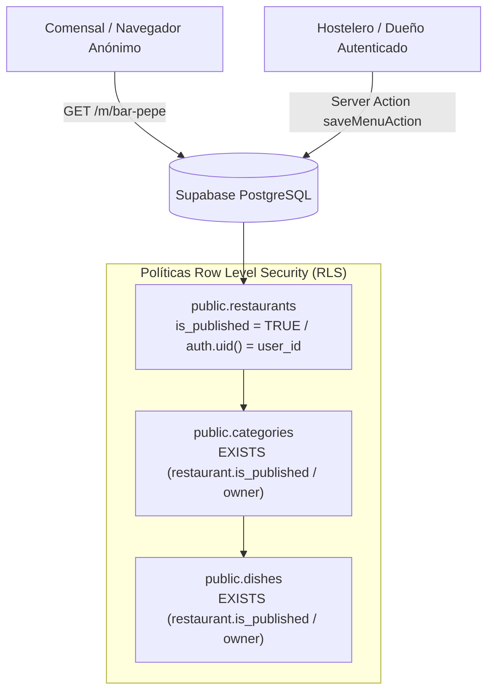

# 🛡️ Guía de Configuración: Supabase, Autenticación y Variables de Entorno

> **Paquete de Trabajo:** WP-2 (`NXE-3`)  
> **Responsable:** `worker-supabase-infra`  
> **Estado:** Consolidado y Validado  
> **Objetivo:** Persistencia Multi-Tenant con Row Level Security (RLS), Onboarding < 3 minutos y 0 € de coste fijo en Supabase Free Tier.

---

## 1. Resumen de Arquitectura y Aislamiento Multi-Tenant

Nexo implementa un modelo **multi-tenant lógico con aislamiento a nivel de fila (Row Level Security)** en PostgreSQL:

* **Separación de Tenants:** Cada restaurante pertenece a un usuario autenticado (`restaurants.user_id = auth.users.id`).
* **Protección de Escritura:** Únicamente el dueño autenticado (`auth.uid() = user_id`) puede crear, modificar o eliminar sus restaurantes, categorías y platos.
* **Lectura Pública Dinámica:** Los comensales y el escaneo de códigos QR (`/m/[slug]`) leen anónimamente restaurantes, categorías y platos **únicamente** si el restaurante tiene `is_published = TRUE`. Restaurantes en borrador o despublicados están 100% aislados e inaccesibles para el público.
* **Eliminación en Cascada:** Al eliminar un restaurante o categoría, la base de datos elimina automáticamente en cascada (`ON DELETE CASCADE`) todas las categorías y platos hijos, previniendo registros huérfanos.



---

## 2. Aprovisionamiento y Despliegue del Esquema DDL

El esquema y las políticas de seguridad están versionados en:
* [`supabase/migrations/001_initial_schema.sql`](file:///Users/jonathanquishpe/JoniDev/Nexo/supabase/migrations/001_initial_schema.sql)
* [`supabase/seed.sql`](file:///Users/jonathanquishpe/JoniDev/Nexo/supabase/seed.sql) (Datos demo de `bar-pepe`)

### Opción A: Despliegue mediante Supabase CLI (Recomendado)
```bash
# 1. Iniciar sesión en Supabase CLI
npx supabase login

# 2. Vincular con el proyecto remoto
npx supabase link --project-ref <TU-PROJECT-REF>

# 3. Aplicar las migraciones
npx supabase db push
```

### Opción B: Despliegue mediante Supabase Studio (Web)
1. Accede a tu panel en [database.new](https://database.new) o al proyecto en [app.supabase.com](https://app.supabase.com).
2. En la barra lateral izquierda, dirígete a **SQL Editor**.
3. Haz clic en **New Query**.
4. Pega el contenido íntegro de [`supabase/migrations/001_initial_schema.sql`](file:///Users/jonathanquishpe/JoniDev/Nexo/supabase/migrations/001_initial_schema.sql) y pulsa **Run**.
5. (Opcional) Ejecuta [`supabase/seed.sql`](file:///Users/jonathanquishpe/JoniDev/Nexo/supabase/seed.sql) si deseas precargar el restaurante demo *Bar Pepe & Tapas*.

---

## 3. Configuración de Proveedores de Autenticación (Supabase Auth)

Nexo está diseñado para un **onboarding sin fricción en menos de 3 minutos**, por lo que se priorizan dos métodos de autenticación que no requieren recordar contraseñas complejas:

### 3.1. Magic Link (Email OTP / Enlace Mágico)
Permite al hostelero introducir su correo y recibir un enlace o código de acceso de un solo uso.

1. En el panel de Supabase, ve a **Authentication** > **Providers** > **Email**.
2. Verifica que el interruptor **Enable Email provider** esté activo.
3. Asegúrate de que **Confirm email** esté habilitado para validar correos reales, o deshabilitado si deseas acceso instantáneo sin verificación previa en fase MVP.
4. En **URL Configuration**:
   * **Site URL:**
     * Desarrollo: `http://localhost:3000`
     * Producción: `https://nexo.menu` (o tu dominio Vercel)
   * **Redirect URLs (Permitidas):**
     * `http://localhost:3000/**`
     * `http://localhost:3000/auth/callback`
     * `https://*-nexo.vercel.app/**`
     * `https://nexo.menu/**`

### 3.2. Google OAuth (Sign In with Google)
Permite inicio de sesión con un solo clic.

1. Ve a [Google Cloud Console](https://console.cloud.google.com/) y crea un proyecto.
2. Ve a **APIs & Services** > **Credentials** > **Create Credentials** > **OAuth Client ID**.
3. Selecciona **Web Application**:
   * **Authorized JavaScript origins:**
     * `http://localhost:3000`
     * `https://nexo.menu`
     * `https://<TU-PROJECT-REF>.supabase.co`
   * **Authorized redirect URIs:**
     * `https://<TU-PROJECT-REF>.supabase.co/auth/v1/callback`
4. Copia el **Client ID** y **Client Secret**.
5. En Supabase Studio, ve a **Authentication** > **Providers** > **Google**:
   * Activa **Enable Google provider**.
   * Pega el **Client ID** y **Client Secret**.
   * Guarda los cambios.

---

## 4. Matriz de Seguridad Row Level Security (RLS)

| Tabla | Operación | Rol Anónimo (`anon`) | Rol Propietario (`authenticated`) | Condición RLS |
| :--- | :---: | :---: | :---: | :--- |
| `restaurants` | `SELECT` | ✅ Sí (si `is_published = true`) | ✅ Sí (cualquier estado) | `is_published = true OR auth.uid() = user_id` |
| `restaurants` | `INSERT` | ❌ Bloqueado | ✅ Sí | `WITH CHECK (auth.uid() = user_id)` |
| `restaurants` | `UPDATE` | ❌ Bloqueado | ✅ Sí | `auth.uid() = user_id` |
| `restaurants` | `DELETE` | ❌ Bloqueado | ✅ Sí | `auth.uid() = user_id` |
| `categories` | `SELECT` | ✅ Sí (si restaurante publicado) | ✅ Sí (sus restaurantes) | `EXISTS (r.is_published = true OR r.user_id = auth.uid())` |
| `categories` | `INSERT/UPDATE/DELETE`| ❌ Bloqueado | ✅ Sí | `EXISTS (r.user_id = auth.uid())` |
| `dishes` | `SELECT` | ✅ Sí (si restaurante publicado) | ✅ Sí (sus restaurantes) | `EXISTS (r.is_published = true OR r.user_id = auth.uid())` |
| `dishes` | `INSERT/UPDATE/DELETE`| ❌ Bloqueado | ✅ Sí | `EXISTS (r.user_id = auth.uid())` |

---

## 5. Variables de Entorno

### 5.1. Definición en `.env.example`

```bash
# -----------------------------------------------------------------------------
# SUPABASE CONFIGURATION
# -----------------------------------------------------------------------------
# URL pública de la instancia de Supabase (Project Settings > API)
NEXT_PUBLIC_SUPABASE_URL=https://your-project-id.supabase.co

# Clave pública anónima (safe for browser exposure, sujeta a RLS)
NEXT_PUBLIC_SUPABASE_ANON_KEY=eyJh...

# Clave de servicio administrativa (SERVER-ONLY, BYPASSES RLS, NUNCA EXPONER AL CLIENTE)
SUPABASE_SERVICE_ROLE_KEY=eyJh...

# URL base de la aplicación (usada para callbacks de autenticación y generación de QR)
NEXT_PUBLIC_APP_URL=http://localhost:3000
```

### 5.2. Inyección de Variables en Vercel
Para el despliegue en Vercel:
1. Dirígete a **Project Settings** > **Environment Variables**.
2. Añade `NEXT_PUBLIC_SUPABASE_URL` para los entornos **Production**, **Preview** y **Development**.
3. Añade `NEXT_PUBLIC_SUPABASE_ANON_KEY` para los mismos entornos.
4. Añade `SUPABASE_SERVICE_ROLE_KEY` seleccionando únicamente **Production** y **Preview** (Server-only).

---

## 6. Pruebas Automatizadas de Persistencia y RLS

Nexo cuenta con una suite de validación automatizada que comprueba 28 puntos críticos de seguridad, integridad referencial y tiempos de respuesta.

Para ejecutarla:
```bash
npm run test:rls
```

La suite valida:
1. **Integridad de Esquema:** Existencia de tablas `restaurants`, `categories` y `dishes`.
2. **Cascada de Claves Foráneas:** Borrado en cascada para evitar datos huérfanos.
3. **Activación de RLS:** Verificación de que RLS está activo en el 100% de las tablas públicas.
4. **Blindaje de Escritura:** Bloqueo estricto a usuarios anónimos o no autorizados.
5. **Aislamiento Multi-Tenant:** 0% de fugas entre identificadores de usuario distintos (`user_id`).
6. **SLA de Consulta Pública:** Comprueba el índice `idx_restaurants_slug` para garantizar respuestas < 50ms en la lectura de cartas públicas.

---

## 7. Solución de Problemas Frecuentes (Troubleshooting)

### Error: `42501 - new row violates row-level security policy`
* **Causa:** Se intentó realizar una inserción o mutación sin un usuario autenticado o con un `user_id` diferente al `auth.uid()` del token de sesión.
* **Solución:** Asegúrate de que el hostelero ha iniciado sesión antes de llamar a `saveMenuAction`. `app/actions/menu.ts` valida automáticamente la presencia de sesión activa.

### Error: `PGRST116 - JSON object requested, multiple (or no) rows returned`
* **Causa:** Una consulta `.single()` no encontró ninguna fila que cumpla las condiciones (por ejemplo, el slug solicitado no existe o `is_published = false`).
* **Solución:** Utilizar `.maybeSingle()` si es esperado que la consulta pueda no retornar resultados, o verificar que `is_published = true` en la base de datos.
