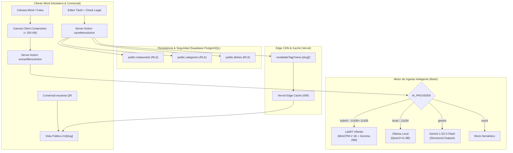

# Nexo ⚡ — Especificación Técnica Consolidada y Contratos de Paquetes de Trabajo (WP-0)

> **Autor:** Nexo-Tech-Lead (`nexo-tech-lead-mvvuxu9e`)  
> **Fecha:** 31 de Octubre de 2026  
> **Estado:** Aprobado / Listo para Delegación a Workers (Temps)  
> **Referencia de Tarea:** NXE-1 (WP-0)

---

## 1. Resumen Ejecutivo y Diagnóstico del Código

Nexo es un Micro-SaaS B2B enfocado en la micro-hostelería (bares de barrio, taperías, cafeterías y restaurantes pequeños) cuya propuesta de valor nuclear es:
> **"Tu restaurante en internet en 3 minutos con una foto y 0 € de coste fijo".**

### 1.1. Diagnóstico del Estado Actual del Proyecto
1. **Frontend & UI/UX (`app/`, `components/`):**
   * Implementado con Next.js 15 (App Router) y Tailwind CSS.
   * Flujo de captura y compresión client-side en Canvas (`< 1536px`, ~250 KB) en `components/admin/ImageUploader.tsx`.
   * Editor táctil (`components/admin/MenuEditor.tsx`) con previsualización inline, selección modal de los 14 alérgenos de la UE y checkbox obligatorio de responsabilidad legal del hostelero.
   * Vista pública del comensal (`app/m/[slug]/page.tsx` + `components/menu/MenuPublicView.tsx`) con filtrado sticky reactivo de alérgenos, selector instantáneo de idioma (ES/EN) y selector de tema claro/oscuro.
   * Generación client-side de QR en PNG (1024x1024 px), SVG vectorial y maquetación de peana A5 lista para imprimir (`components/qr/QrDownloadModal.tsx`).
2. **Pipeline de Ingesta IA (`lib/ai/`, `lib/gemini/`, `app/actions/ai.ts`):**
   * Motor multi-proveedor desacoplado con conmutación inteligente (`auto`, `hybrid`/`litert_hybrid`, `litert`, `local`/`ollama`, `gemini`, `mock`).
   * Soporte para el **Pipeline Híbrido LiteRT en 2 fases**: MiniCPM-V 4.7-1B (:11436) para OCR/visión tabular + Gemma 4 26B (:11435) para razonamiento culinario, deducción de alérgenos UE y validación Zod.
   * Extracción Cloud con Gemini Flash estructurado (`response_schema`).
   * Catálogo normativo inmutable de los 14 alérgenos UE (Reglamento 1169/2011) en `lib/allergens.ts`.
3. **Persistencia y Backend (`lib/supabase/`, `lib/data/menu.ts`, `app/actions/menu.ts`):**
   * Clientes SSR (`@supabase/ssr`) para browser y servidor.
   * Server Actions seguras: `saveMenuAction` (upsert transaccional de restaurante, categorías y platos) e invalidación de caché atómica mediante `revalidateTag('menu-[slug]')`.
   * Capa de datos con fallback automático a mock cuando Supabase no está configurado, permitiendo desarrollo local autónomo.

---

## 2. Arquitectura de Referencia Consolidada



### 2.1. Normativa Europea de Alérgenos (Reglamento UE 1169/2011)
El sistema implementa estrictamente los 14 alérgenos mediante claves técnicas en `snake_case`:
`gluten`, `crustaceans`, `eggs`, `fish`, `peanuts`, `soybeans`, `dairy`, `nuts`, `celery`, `mustard`, `sesame`, `sulphites`, `lupin`, `molluscs`.
* **Cláusula de Salvaguarda Legal:** El hostelero debe validar expresamente: *"Confirmo que he verificado los ingredientes, precios y alérgenos de cada plato. Reconozco que la IA actúa únicamente como asistente y asumo la responsabilidad legal ante los clientes."*

---

## 3. Matriz de Paquetes de Trabajo (WPs)

| WP ID | Título | Agente / Worker Responsable | Dependencias | Prioridad |
| :--- | :--- | :--- | :--- | :--- |
| **WP-0** | Análisis y Especificación Técnica Base | `nexo-tech-lead` | Ninguna | Crítica (Done) |
| **WP-1** | Entorno, Git & Repositorio Remoto | `worker-git-devops` | WP-0 | Alta |
| **WP-2** | Persistencia Multi-Tenant & Supabase | `worker-supabase-infra` | WP-1 | Alta |
| **WP-3** | Despliegue Vercel Edge & Validación ISR | `worker-vercel-edge` | WP-2 | Alta |
| **WP-4** | Calibración y Benchmark de Ingesta IA | `worker-ai-benchmark` | WP-1 | Media |
| **WP-5** | Piloto de Validación en Mesa y QA de Campo | `worker-qa-field` | WP-3, WP-4 | Alta |

---

## 4. Contratos de Delegación para Workers (Temps)

Los workers se ejecutan como agentes temporales (`temps`) en ramas de trabajo aisladas (`git worktree`) según el protocolo del Hive.

---

### Contrato WP-1: Entorno, Git & Repositorio Remoto
* **ID:** `WP-1-GIT-DEVOPS`
* **Worker Propuesto:** `worker-git-devops`
* **Objetivo:**
  1. Configurar la higiene del repositorio: actualizar `.gitignore` asegurando exclusión de `.next`, `.env*.local`, credenciales y artefactos de build.
  2. Crear el commit fundacional estructurado con Conventional Commits (`feat: initial production-ready codebase for Nexo MVP`).
  3. Validar y unificar las plantillas de entorno (`.env.example` vs `.env.local`).
  4. Dejar el repositorio listo para conectar con remoto GitHub (`origin/main`).
* **Entregables:**
  * Historial git limpio con commit inicial.
  * Archivo `.gitignore` robusto que garantice compilación limpia sin bloqueos de permisos.
  * Archivo `.env.example` completo y documentado con todas las variables necesarias (Supabase, Gemini, LiteRT, Ollama).
* **Criterios de Aceptación:**
  * `git status` limpio sin archivos basura ni de caché rastreados.
  * `npm run lint` pasa sin errores bloqueantes.
* **Comando / Request Template:**
```json
{
  "objective": "Realizar la higiene de Git, commit inicial de producción y estandarización de .env.example para Nexo",
  "cwd": "/Users/jonathanquishpe/JoniDev/Nexo",
  "cloneOf": "nexo-tech-lead-mvvuxu9e"
}
```

---

### Contrato WP-2: Persistencia Multi-Tenant & Supabase
* **ID:** `WP-2-SUPABASE-INFRA`
* **Worker Propuesto:** `worker-supabase-infra`
* **Objetivo:**
  1. Consolidar el script de migración SQL DDL en un archivo ejecutable (`supabase/migrations/001_initial_schema.sql`).
  2. Implementar y verificar las políticas de Row Level Security (RLS) para aislamiento multi-tenant:
     * Lectura pública de restaurantes (`is_published = true`), categorías y platos.
     * Escritura restringida exclusivamente a `auth.uid() = user_id`.
  3. Asegurar la integridad referencial (`ON DELETE CASCADE`) y los índices de rendimiento (`slug`, `restaurant_id`, `category_id`).
  4. Desarrollar un test unitario / script de verificación (`scripts/verify-supabase.ts` o suite equivalente) que valide el ciclo completo de mutación con RLS activo.
* **Entregables:**
  * Archivo `supabase/migrations/001_initial_schema.sql` listo para ejecución en Supabase Studio / CLI.
  * Script de validación de conexión y testing de consultas/mutaciones.
  * Documentación breve de configuración de Auth (Magic Link y Google).
* **Criterios de Aceptación:**
  * Intentos de inserción/modificación sin usuario autenticado fallan con error RLS.
  * Consultas públicas por `slug` resuelven en < 50ms sin leak de datos de otros tenants.
* **Comando / Request Template:**
```json
{
  "objective": "Consolidar DDL, políticas RLS y script de pruebas de persistencia multi-tenant para Supabase",
  "cwd": "/Users/jonathanquishpe/JoniDev/Nexo",
  "cloneOf": "nexo-tech-lead-mvvuxu9e"
}
```

---

### Contrato WP-3: Despliegue Vercel Edge & Validación ISR
* **ID:** `WP-3-VERCEL-EDGE`
* **Worker Propuesto:** `worker-vercel-edge`
* **Objetivo:**
  1. Configurar la integración y despliegue continuo en Vercel (Hobby Tier).
  2. Verificar que las Server Actions y la regeneración estática (`revalidateTag`) operan correctamente en Vercel Edge Network.
  3. Auditar el bundle de cliente y los Core Web Vitals de la carta pública (`/m/[slug]`):
     * First Load JS < 150 kB.
     * Largest Contentful Paint (LCP) < 500 ms en móvil.
     * Cero llamadas a base de datos en lecturas cacheadas.
  4. Configurar dominios y cabeceras de seguridad HTTP (CSP, X-Frame-Options, HSTS).
* **Entregables:**
  * Archivo `vercel.json` o configuración de routing optimizada.
  * Informe de auditoría Lighthouse / Web Vitals en `/m/bar-pepe`.
  * Prueba de revalidación atómica tras edición de un plato.
* **Criterios de Aceptación:**
  * Despliegue en verde en Vercel con SSL activo.
  * Puntuación de Performance en Lighthouse móvil >= 95.
* **Comando / Request Template:**
```json
{
  "objective": "Configurar y auditar el despliegue en Vercel Edge con validación de ISR revalidateTag y optimización de Web Vitals",
  "cwd": "/Users/jonathanquishpe/JoniDev/Nexo",
  "cloneOf": "nexo-tech-lead-mvvuxu9e"
}
```

---

### Contrato WP-4: Calibración y Benchmark de Ingesta IA
* **ID:** `WP-4-AI-BENCHMARK`
* **Worker Propuesto:** `worker-ai-benchmark`
* **Objetivo:**
  1. Crear un dataset de evaluación con fotos reales de cartas de hostelería española (pizarras con tiza, cartas plastificadas, menús con varias columnas, tipografías manuscritas).
  2. Ejecutar un benchmark comparativo automatizado (`scripts/benchmark-ai.ts`):
     * **Motor A:** Pipeline Híbrido LiteRT (MiniCPM-V 1B [:11436] + Gemma 4 26B [:11435]).
     * **Motor B:** Ollama Local (Qwen3-VL:8B [:11434]).
     * **Motor C:** Google Gemini 1.5/2.0 Flash API.
  3. Medir métricas clave:
     * Tasa de acierto en extracción de platos y precios (Accuracy / Precision).
     * Recall y Precision en la detección de los 14 alérgenos UE obligatorios.
     * Latencia de inferencia (segundos de extremo a extremo).
     * Consumo de RAM y coste económico por menú.
* **Entregables:**
  * Script ejecutable de benchmark con reporting en Markdown y JSON.
  * Informe comparativo formal con recomendaciones de calibración de prompts y umbrales de confianza.
* **Criterios de Aceptación:**
  * El motor híbrido y cloud superan el 90% de precisión en alérgenos de recetas estándar (croquetas, tortilla, ensaladilla).
  * Tiempo total de procesamiento inferior a 4 segundos por carta.
* **Comando / Request Template:**
```json
{
  "objective": "Implementar suite de benchmark comparativo entre LiteRT Híbrido, Ollama y Gemini Flash con cartas reales",
  "cwd": "/Users/jonathanquishpe/JoniDev/Nexo",
  "cloneOf": "nexo-tech-lead-mvvuxu9e"
}
```

---

### Contrato WP-5: Piloto de Validación en Mesa y QA de Campo
* **ID:** `WP-5-QA-FIELD`
* **Worker Propuesto:** `worker-qa-field`
* **Objetivo:**
  1. Validar la experiencia de usuario real en condiciones de hostelería física:
     * Generar e imprimir plantilla A5 en soporte físico (peana acrílica / caballete de mesa).
     * Verificar escaneabilidad del QR con cámaras nativas de iOS y Android a distintas distancias y condiciones de luz.
  2. Ejecutar pruebas de estrés de usabilidad con hosteleros reales:
     * Cronometrar el flujo de onboarding completo (desde foto hasta QR listo): ¿cumple el objetivo de < 180 segundos?
     * Registrar porcentaje de correcciones requeridas en el `MenuEditor`.
  3. Ejecutar pruebas con comensales reales:
     * Comprensión del filtro sticky de alérgenos y cambio de idioma sin asistencia.
* **Entregables:**
  * Informe de QA de campo con métricas de tiempo real, tasa de error y feedback cualitativo.
  * Checklist de mejoras ergonómicas para la Fase Post-MVP.
* **Criterios de Aceptación:**
  * 100% de éxito en escaneo de QR en menos de 1,5 segundos.
  * TTV verificado inferior a 3 minutos en al menos 2 casos de prueba reales.
* **Comando / Request Template:**
```json
{
  "objective": "Ejecutar protocolo de validación piloto en mesa física, escaneo QR y cronometraje de TTV < 3 minutos",
  "cwd": "/Users/jonathanquishpe/JoniDev/Nexo",
  "cloneOf": "nexo-tech-lead-mvvuxu9e"
}
```

---

## 5. Próximos Pasos Inmediatos para el Hive

1. **Notificación al Orquestador (`god`):** Presentar la consolidación de WP-0 para aprobación formal y actualización de `board.md`.
2. **Lanzamiento de WP-1:** Poner en marcha el worker de Git/DevOps para crear el commit inicial y asentar las bases del repositorio.
3. **Paralelización de WP-2 y WP-4:** Una vez estabilizado el repositorio, lanzar en paralelo el worker de Supabase y el de Benchmark IA.
