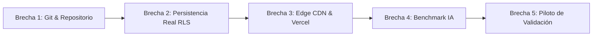
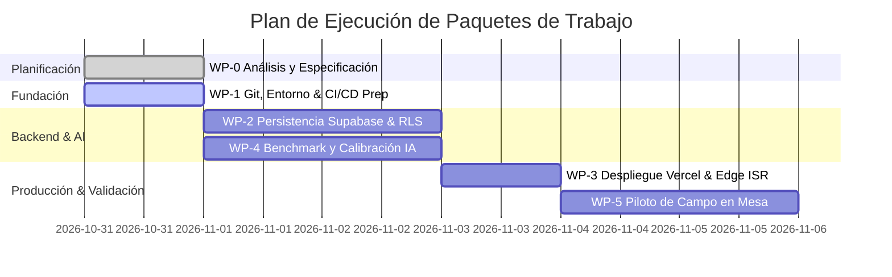

# Nexo ⚡ — Especificación Técnica y Definición de Paquetes de Trabajo

> **Documento:** Paquetes de Trabajo y Contratos de Delegación para Producción  
> **Autor:** Nexo-Tech-Lead (`nexo-tech-lead-mvvuxu9e`)  
> **Destinatario:** Michael (`god`) / Workers (Temps)  
> **Referencia de Tarea:** `NXE-1`  
> **Fecha:** 31 de Octubre de 2026  
> **Estado:** Aprobado / Listo para Despacho

---

## 1. Resumen Ejecutivo y Diagnóstico del Código Existente

Nexo es un Micro-SaaS B2B para micro-hostelería (bares de barrio, cafeterías, taperías y restaurantes locales) cuya propuesta nuclear es:
> **"Tu restaurante en internet en 3 minutos con una foto y 0 € de coste fijo".**

### 1.1. Componentes Ya Construidos y Validados en Local
Tras la auditoría exhaustiva del repositorio (`app/`, `components/`, `lib/`, `docs/`), se confirma que la base del MVP está construida y funcional en entorno de desarrollo:

1. **Frontend y UX (`app/`, `components/`):**
   * **Landing & Onboarding (`app/page.tsx`):** Flujo directo sin fricción.
   * **Subida y Pre-compresión (`components/admin/ImageUploader.tsx`):** Compresión client-side en Canvas (`< 1536px`, ~250 KB) que reduce el consumo de red en conexiones móviles 3G/4G y optimiza los tokens de visión.
   * **Editor Táctil de Menú (`components/admin/MenuEditor.tsx`):** Edición inline de categorías, platos y precios; selector modal táctil con los **14 alérgenos obligatorios de la UE** ([Reglamento 1169/2011](https://eur-lex.europa.eu/legal-content/ES/TXT/?uri=CELEX:32011R1169)); y checkbox legal mandatorio que exime de responsabilidad al software.
   * **Carta Pública del Comensal (`app/m/[slug]/page.tsx` + `components/menu/MenuPublicView.tsx`):** Barra sticky horizontal de filtrado reactivo de alérgenos, conmutador instantáneo de idioma (ES/EN) y alternador de tema claro/oscuro.
   * **Generador de Material Físico (`components/qr/QrDownloadModal.tsx`):** Exportación de QR en PNG (1024x1024 px), SVG vectorial y maquetación de peana A5 lista para imprimir con `window.print()`.

2. **Pipeline de Ingesta IA Multi-Motor (`lib/ai/`, `lib/gemini/`, `app/actions/ai.ts`):**
   * Arquitectura desacoplada en `lib/ai/index.ts` con enrutamiento dinámico (`auto`, `hybrid`/`litert_hybrid`, `litert`, `local`/`ollama`, `gemini`, `mock`).
   * **Pipeline Híbrido LiteRT (2 fases):**
     * *Fase 1 (Visión/OCR):* `MiniCPM-V 4.7-1B` en `:11436` (~1.3s, 2.3 GB RAM).
     * *Fase 2 (Razonamiento/Zod):* `Gemma 4 26B A4B` en `:11435` (~1.7s, alérgenos y traducción).
   * **Ollama Local:** Soporte para `qwen3-vl:8B` en `:11434`.
   * **Google Gemini Cloud:** Inferencia multimodal estructurada con `response_schema` en `lib/gemini/extract.ts`.
   * **Simulación Mock:** Fallback transparente para desarrollo offline.

3. **Capa de Persistencia y Server Actions (`lib/supabase/`, `lib/data/menu.ts`, `app/actions/menu.ts`):**
   * Configuración de cliente SSR (`@supabase/ssr`).
   * Server Action `saveMenuAction` que realiza upsert relacional de restaurante, categorías y platos.
   * Invalidación atómica de caché edge mediante `revalidateTag('menu-[slug]')`.

---

## 2. Análisis de Brechas Técnicas para Puesta en Producción

Para transitar del prototipo MVP local a un producto comercial robusto con 0 € de coste fijo, se identifican las siguientes **5 brechas críticas**:



| Brecha | Área | Diagnóstico Actual | Riesgo / Impacto | Solución Requerida |
| :--- | :--- | :--- | :--- | :--- |
| **B-1** | Git & Entorno | No existe commit inicial (`No commits yet`). Archivos generados en `.next` tienen permisos residuales que provocan fallos de `EPERM` en builds limpios. | Impide la reproducibilidad en CI/CD y despliegues en Vercel. | Actualizar `.gitignore`, limpiar `.next`, estandarizar `.env.example` y realizar commit inicial estructurado. |
| **B-2** | Supabase & RLS | La aplicación opera en modo demo / mock. El script DDL (`docs/fase2...`) no está versionado como migración ejecutable ni se han verificado las políticas RLS en un proyecto real. | Riesgo de fuga de datos multi-tenant o fallos en Server Actions al conectar producción. | Crear `supabase/migrations/001_initial_schema.sql`, verificar RLS (`auth.uid() = user_id`) y escribir script de validación. |
| **B-3** | Edge & ISR | No hay pipeline de despliegue continuo configurado ni auditoría de Web Vitals en condiciones de red móvil deficiente (3G/4G). | Si el First Load JS supera los 150 kB o el LCP excede 500 ms, la tasa de rebote del comensal en mesa será alta. | Conectar Vercel CI/CD, configurar cabeceras de seguridad, verificar `revalidateTag` y auditar con Lighthouse. |
| **B-4** | Ingesta IA | Los prompts y esquemas han sido probados con mocks y cartas ideales; falta calibración empírica con cartas físicas reales (pizarras con tiza, fotos torcidas, reflejos). | Falsos positivos o negativos en alérgenos de la UE comprometen la seguridad alimentaria y la credibilidad del software. | Suite de benchmark automatizada (`scripts/benchmark-ai.ts`) comparando LiteRT Híbrido vs Ollama vs Gemini Flash con métricas de Recall/Precision. |
| **B-5** | Validación Física | No se ha validado en el mundo real la legibilidad del QR impreso en peana A5 ni el cronometraje del onboarding (*TTV < 180 segundos*). | La propuesta de valor central no está probada con hosteleros y comensales en entorno de servicio real. | Prueba de campo con 2 establecimientos reales, medición de tiempos y registro de fricción en el editor táctil. |

---

## 3. Desglose de Paquetes de Trabajo (Work Packages)



---

### WP-1: Entorno, Git & Repositorio Remoto (Inicialización GitFlow)
* **ID:** `WP-1` (Ticket [`NXE-2`](file:///Users/jonathanquishpe/JoniDev/Nexo/hive/tasks.json))
* **Asignado a:** `worker-git-devops` (Temp)
* **Dependencias:** `NXE-1` (WP-0)
* **Prioridad:** Alta
* **Guía de Referencia:** [`docs/estrategia_gitflow.md`](file:///Users/jonathanquishpe/JoniDev/Nexo/docs/estrategia_gitflow.md)
* **Objetivo:**
  1. Configurar `.gitignore` robusto excluyendo `.next`, archivos de entorno privados (`.env*.local`), archivos de soporte y artefactos de compilación.
  2. Limpiar residuos de compilación previos para garantizar que `npm run build` y `npm run lint` pasen con éxito en cualquier entorno.
  3. Estandarizar `.env.example` documentando todas las variables requeridas (Supabase, Gemini, Ollama, LiteRT).
  4. Crear el commit fundacional con formato Conventional Commits en `main`:
     `feat: initial production-ready release for Nexo MVP`
  5. Inicializar la arquitectura de ramas GitFlow:
     * Crear rama `develop` a partir de `main` (entorno de desarrollo e integración continua).
     * Crear rama `test` a partir de `develop` (entorno de pruebas y control de calidad / QA).
     * Dejar `develop` activa como base de trabajo para los workers.
* **Entregables:**
  * Historial Git inicial limpio en rama `main`.
  * Ramas `develop` y `test` creadas y sincronizadas.
  * `.gitignore` actualizado y libre de archivos no deseados.
  * `.env.example` completo y documentado.
* **Criterios de Aceptación:**
  * `git status` muestra un working tree limpio.
  * Ramas `main`, `develop` y `test` verificadas con `git branch -a`.
  * `npm run lint` ejecuta sin advertencias ni errores.

---

### WP-2: Persistencia Multi-Tenant & Supabase
* **ID:** `WP-2` (Ticket [`NXE-3`](file:///Users/jonathanquishpe/JoniDev/Nexo/hive/tasks.json))
* **Asignado a:** `worker-supabase-infra` (Temp)
* **Dependencias:** `NXE-2` (WP-1)
* **Prioridad:** Alta
* **Objetivo:**
  1. Versionar el esquema DDL relacional en `supabase/migrations/001_initial_schema.sql` cubriendo:
     * Tablas: `public.restaurants`, `public.categories`, `public.dishes`.
     * Índices: `slug`, `restaurant_id`, `category_id`, `order_index`.
     * Eliminación en cascada (`ON DELETE CASCADE`).
  2. Implementar y auditar las políticas de **Row Level Security (RLS)**:
     * Lectura pública anónima en restaurantes donde `is_published = true`.
     * Modificación, inserción y borrado estrictamente restringidos al dueño (`auth.uid() = user_id`).
  3. Crear un script automatizado de validación (`scripts/test-supabase-rls.ts`) que intente:
     * Inserción no autorizada (debe fallar por RLS).
     * Consulta pública por slug (debe retornar el menú completo en < 50ms).
     * Modificación autorizada de disponibilidad de plato (`is_available`).
* **Entregables:**
  * Archivo de migración `supabase/migrations/001_initial_schema.sql`.
  * Script de prueba y verificación de seguridad RLS.
  * Documentación paso a paso de configuración de proyecto en Supabase (Auth Magic Link / Google).
* **Criterios de Aceptación:**
  * 0% de fugas de datos entre distintos `user_id`.
  * Las Server Actions en `app/actions/menu.ts` guardan y leen datos reales en Supabase sin errores de tipo.

---

### WP-3: Despliegue Vercel Edge & Validación ISR
* **ID:** `WP-3` (Ticket [`NXE-4`](file:///Users/jonathanquishpe/JoniDev/Nexo/hive/tasks.json))
* **Asignado a:** `worker-vercel-edge` (Temp)
* **Dependencias:** `NXE-3` (WP-2)
* **Prioridad:** Alta
* **Objetivo:**
  1. Configurar el proyecto para despliegue continuo en Vercel (Hobby Tier, 0 € de coste fijo).
  2. Inyectar variables de entorno de producción y configurar cabeceras HTTP de seguridad (CSP, HSTS, X-Content-Type-Options).
  3. Validar el ciclo de vida de **Incremental Static Regeneration (ISR)**:
     * Verificación de que `/m/[slug]` se sirve desde la caché de borde (Vercel Edge CDN).
     * Comprobar que al ejecutar `saveMenuAction` la llamada a `revalidateTag('menu-[slug]')` invalida la caché instantáneamente.
  4. Realizar auditoría de rendimiento en móvil con Google Lighthouse:
     * First Load JS < 150 kB.
     * LCP (Largest Contentful Paint) < 500 ms.
     * Performance Score >= 95.
* **Entregables:**
  * Configuración de despliegue en `vercel.json` (si aplica) y documentación de variables.
  * Informe de auditoría Web Vitals de la carta `/m/bar-pepe`.
  * Prueba documentada de invalidación de caché atómica.
* **Criterios de Aceptación:**
  * Cero consultas a Supabase en lecturas concurrentes de cartas ya cacheadas.
  * Despliegue en verde con URL pública activa bajo HTTPS.

---

### WP-4: Calibración y Benchmark de Ingesta IA
* **ID:** `WP-4` (Ticket [`NXE-5`](file:///Users/jonathanquishpe/JoniDev/Nexo/hive/tasks.json))
* **Asignado a:** `worker-ai-benchmark` (Temp)
* **Dependencias:** `NXE-2` (WP-1)
* **Prioridad:** Media
* **Objetivo:**
  1. Crear un dataset de prueba con imágenes reales representativas de la hostelería española:
     * Carta impresa tradicional a 2 columnas.
     * Pizarra de bar escrita a mano con tiza.
     * Menú del día en papel doblado con iluminación irregular.
  2. Implementar una suite de benchmark automatizada (`scripts/benchmark-ai.ts`) que ejecute y compare:
     * **Opción A (LiteRT Híbrido):** MiniCPM-V 1B (:11436) + Gemma 4 26B (:11435).
     * **Opción B (Ollama Local):** Qwen3-VL:8B (:11434).
     * **Opción C (Gemini Cloud):** Google Gemini 1.5/2.0 Flash API.
  3. Calcular métricas cuantitativas:
     * *Precisión de Platos y Precios:* % de platos y valores monetarios correctamente parseados.
     * *Recall de Alérgenos UE:* Tasa de detección de los alérgenos obligatorios en recetas típicas (croquetas, tortilla, ensaladilla, bravas).
     * *Latencia y Consumo:* Tiempo de respuesta (segundos) y memoria RAM ocupada en Apple Silicon.
* **Entregables:**
  * Script `scripts/benchmark-ai.ts` ejecutable vía CLI.
  * Informe comparativo formal en Markdown con resultados tabulados.
  * Ajustes y optimización de prompts en `lib/gemini/prompt.ts` y `lib/ai/litert_hybrid.ts` según los hallazgos.
* **Criterios de Aceptación:**
  * Recall de alérgenos > 90% en recetas estándar españolas.
  * Latencia de ingesta total inferior a 4 segundos por carta.

---

### WP-5: Piloto de Validación en Mesa y QA de Campo
* **ID:** `WP-5` (Ticket [`NXE-6`](file:///Users/jonathanquishpe/JoniDev/Nexo/hive/tasks.json))
* **Asignado a:** `worker-qa-field` (Temp)
* **Dependencias:** `NXE-4` (WP-3), `NXE-5` (WP-4)
* **Prioridad:** Alta
* **Objetivo:**
  1. Validar la experiencia física del producto:
     * Imprimir peana / caballete de mesa en formato A5 desde el modal de Nexo (`components/qr/QrDownloadModal.tsx`).
     * Comprobar la tasa de escaneo instantáneo del QR con cámaras nativas de iOS (iPhone) y Android (Samsung, Pixel, Xiaomi) a distancias de 30 cm a 1 metro con luz tenue de restaurante.
  2. Realizar test de campo con al menos dos negocios reales o simulados:
     * Medir el Time-to-Value (TTV): ¿Logra el hostelero publicar su carta en < 3 minutos (180s)?
     * Medir la tasa de correcciones manuales en el editor: ¿Requiere corregir menos del 10% de los platos?
  3. Probar la experiencia del comensal:
     * Comprobar la respuesta del filtro de alérgenos sticky en móvil con una sola mano.
     * Probar el cambio de idioma instantáneo por comensales no hispanohablantes.
* **Entregables:**
  * Informe de Validación de Campo con cronometrajes reales y evidencias fotográficas.
  * Matriz de retroalimentación de UX para la Fase Post-MVP (vídeos cortos tipo Reels, propinas, etc.).
* **Criterios de Aceptación:**
  * TTV demostrado menor a 180 segundos.
  * Escaneo del QR en menos de 1,5 segundos sin descargas de apps de terceros.

---

## 4. Contratos de Delegación para Workers (Spawn Requests)

Para lanzar cualquiera de estos paquetes mediante temps en el Hive, el orquestador (`god`) o el tech lead depositará un archivo JSON en `spawn-requests/<id>.json` respetando el formato estricto del protocolo:

### 4.1. Request Template para WP-1 (Git & DevOps - GitFlow)
```json
{
  "objective": "Ejecutar WP-1: Configuración de .gitignore, eliminación de bloqueos de compilación en .next, estandarización de .env.example, commit fundacional en main e inicialización de ramas develop y test conforme a docs/estrategia_gitflow.md.",
  "cwd": "/Users/jonathanquishpe/JoniDev/Nexo",
  "cloneOf": "nexo-tech-lead-mvvuxu9e",
  "name": "worker-git-devops"
}
```

### 4.2. Request Template para WP-2 (Supabase Infra)
```json
{
  "objective": "Ejecutar WP-2: Consolidación de script DDL en supabase/migrations/001_initial_schema.sql, verificación de políticas RLS multi-tenant y desarrollo de script de pruebas de persistencia.",
  "cwd": "/Users/jonathanquishpe/JoniDev/Nexo",
  "cloneOf": "nexo-tech-lead-mvvuxu9e",
  "name": "worker-supabase-infra"
}
```

### 4.3. Request Template para WP-3 (Vercel Edge & ISR)
```json
{
  "objective": "Ejecutar WP-3: Configuración de despliegue continuo en Vercel Edge, validación de revalidateTag ISR y auditoría de Web Vitals (LCP < 500ms, First Load JS < 150kB).",
  "cwd": "/Users/jonathanquishpe/JoniDev/Nexo",
  "cloneOf": "nexo-tech-lead-mvvuxu9e",
  "name": "worker-vercel-edge"
}
```

### 4.4. Request Template para WP-4 (AI Benchmark)
```json
{
  "objective": "Ejecutar WP-4: Implementar suite de benchmark comparativo (scripts/benchmark-ai.ts) entre LiteRT Híbrido, Ollama y Gemini Flash con cartas físicas reales y alérgenos UE.",
  "cwd": "/Users/jonathanquishpe/JoniDev/Nexo",
  "cloneOf": "nexo-tech-lead-mvvuxu9e",
  "name": "worker-ai-benchmark"
}
```

### 4.5. Request Template para WP-5 (QA en Mesa)
```json
{
  "objective": "Ejecutar WP-5: Validación física de impresión de peana A5, prueba de escaneo QR en mesa y verificación de onboarding en menos de 180 segundos con usuarios reales.",
  "cwd": "/Users/jonathanquishpe/JoniDev/Nexo",
  "cloneOf": "nexo-tech-lead-mvvuxu9e",
  "name": "worker-qa-field"
}
```

---

## 5. Recomendación de Secuenciación y Próximos Pasos

1. **Aprobación de `god`:** Con la entrega de este documento se cierra contractualmente `NXE-1` (WP-0).
2. **Despacho Inmediato de WP-1:** Se debe iniciar `worker-git-devops` para formalizar el commit inicial y estabilizar la base de control de versiones.
3. **Paralelización de WP-2 y WP-4:** Una vez saneado el repositorio con WP-1, los paquetes de base de datos (WP-2) y calibración de IA (WP-4) pueden ejecutarse de manera completamente desacoplada y concurrente.
