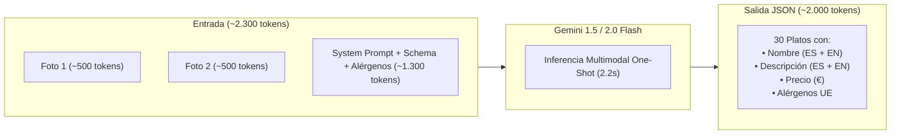
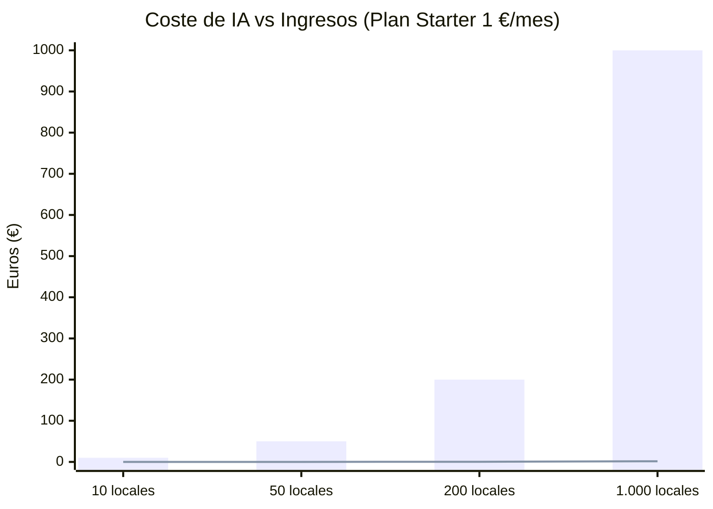

# Estimación de Ingesta IA con Gemini Flash y Ventajas de Google AI Pro

> **Proyecto:** Nexo  
> **Objetivo:** Estudio de viabilidad técnica, costes, tiempos de respuesta y ventajas de la suscripción/cuenta Pro para la ingesta automatizada de cartas con Google Gemini Flash.

---

## 1. Desglose de Tokens y Costes por Menú

La ingesta IA es el **core diferencial** de Nexo. Para que el modelo de 1 €/mes sea viable (y el Plan Free no genere pérdidas), el coste marginal de procesar una carta física debe ser de fracciones de céntimo de euro.

### 1.1. Anatomía de una Petición Típica (Menú de Bar/Restaurante Pequeño)

Un establecimiento estándar cuenta con:
* **Entrada visual:** 2 fotografías (Carta cara A y cara B, o pizarra + menú del día).
* **Volumen:** 30 a 40 platos distribuidos en 4 o 5 categorías (Tapas, Raciones, Principales, Postres, Bebidas).
* **Tareas simultáneas en una única llamada:**
  1. Extracción de textos, secciones y precios.
  2. Inferencia y sugerencia de los 14 alérgenos de la UE.
  3. Traducción automática simultánea al inglés.

### 1.2. Cálculo Detallado de Coste por Carta

Precios oficiales de **Gemini 1.5 Flash / 2.0 Flash** (por cada 1.000.000 de tokens):
* **Tokens de entrada:** $0,075 - $0,10 por 1M tokens.
* **Tokens de salida:** $0,30 - $0,40 por 1M tokens.

| Concepto | Volumen de Tokens | Coste Unitario (USD) | Coste Unitario (EUR aprox.) |
| :--- | :--- | :--- | :--- |
| **Entrada (2 fotos + Prompt + Schema)** | ~2.300 tokens | $0,00019 | ~0,00018 € |
| **Salida (JSON con alérgenos + inglés)** | ~2.000 tokens | $0,00065 | ~0,00060 € |
| **TOTAL POR CARTA COMPLETA** | **~4.300 tokens** | **~$0,00084** | **~0,00078 €** |

> [!NOTE]  
> **Conclusión Económica Directa:**  
> Procesar una carta entera cuesta **menos de 0,001 € (una décima de céntimo)**.  
> Con **1 € de consumo en Gemini Flash puedes procesar más de 1.200 cartas completas**.

---

## 2. Comparativa: Capa Gratuita vs Suscripción / Cuenta Pro

Existen dos formas de operar con Google AI: la capa pública gratuita de Google AI Studio y el nivel de pago / cuenta Pro (*Tier Pay-As-You-Go / Google Cloud Vertex AI*).

| Característica | Capa Gratuita (Free Tier) | Cuenta Pro / Pago por Uso (Tier 1) | Impacto en Nexo |
| :--- | :--- | :--- | :--- |
| **Coste fijo mensual** | 0 € / mes | 0 € fijos (solo pagas lo que consumes) | Idóneo para arrancar sin gastos fijos. |
| **Límite de peticiones por minuto (RPM)** | 15 RPM | **1.000+ RPM** | Evita errores si varios bares se registran a la vez. |
| **Límite diario (RPD)** | 1.500 peticiones / día | **Sin límite diario** | Permite campañas virales sin bloqueo de cuota. |
| **Privacidad de Datos y RGPD** | ⚠️ Los datos pueden usarse para re-entrenar modelos de Google | 🔒 **Datos 100% privados**. Google **NO** entrena con tus imágenes ni datos | **Crítico para cumplimiento legal en España/UE**. |
| **Latencia y SLA** | Prioridad compartida (cola pública) | **Prioridad alta garantizada** | Respuesta fluida en 2-3 segundos. |
| **Context Caching** | No disponible / Limitado | Disponible (descuento del 75% en tokens de entrada) | Si el prompt de alérgenos se cachea, el coste baja aún más. |

> [!IMPORTANT]  
> **El factor decisivo de la cuenta Pro:**  
> Más allá de la cuota, la ventaja clave de habilitar la cuenta de pago/Pro en Google AI es la **privacidad comercial (RGPD)**: los hosteleros suben fotos de sus locales, nombres y cartas; una cuenta Pro garantiza por contrato que Google no almacena ni reutiliza esas fotos para re-entrenar su IA.

---

## 3. Simulación de Costes y Rentabilidad a Escala

Considerando que el hostelero medio procesa su carta inicial al registrarse y realiza una media de **1 actualización mensual** (menú del día o cambio de precios):

| Número de Bares Activos | Ingestas IA / Mes (Registro + Updates) | Coste Total IA al Mes | Ingresos con Plan 1€ | Margen Bruto de IA |
| :--- | :--- | :--- | :--- | :--- |
| **10 locales** | ~20 extracciones | **0,016 €** | 10 € | **99,8%** |
| **50 locales** | ~100 extracciones | **0,08 €** | 50 € | **99,8%** |
| **200 locales** | ~400 extracciones | **0,32 €** | 200 € | **99,8%** |
| **1.000 locales** | ~2.000 extracciones | **1,60 €** | 1.000 € | **99,8%** |

Incluso para los usuarios del **Plan Free**, el coste de asumir sus extracciones de por vida es prácticamente imperceptible (ej. 500 bares en el plan gratuito costarían menos de 0,50 € al mes en IA).

---

## 4. Tiempos de Respuesta (Latencia y Experiencia de Usuario)

Para que el hostelero no abandone el proceso en el onboarding:
1. **Compresión previa en navegador:** La foto del móvil (de 4 a 10 MB) se comprime en el cliente a ~1536x1536 px (JPEG a 80%, ~250 KB). Tiempo de subida: **< 1 segundo**.
2. **Inferencia en Gemini Flash:**
   * Detección visual y OCR: ~0,8 segundos.
   * Generación del JSON estructurado con alérgenos y traducción: ~1,4 segundos.
   * **Tiempo total de respuesta de la IA:** **~2,2 a 2,8 segundos**.
3. **Sensación percibida (UX):** Con un indicador visual de progreso (*"Leyendo platos... Identificando alérgenos... Traduciendo al inglés"*), 2,5 segundos transmite una sensación de magia tecnológica instantánea.

---

## 5. Estrategias de Optimización Recomendadas para el Proyecto

1. **One-Shot Extraction (Todo en una llamada):**  
   No realizar una llamada para OCR, otra para alérgenos y otra para traducir. Gemini Flash tiene suficiente capacidad multimodal y de razonamiento para resolver las tres tareas en un único prompt con `response_schema`.
2. **Salvaguarda contra abusos en el Plan Free:**  
   Limitar a **3 intentos de escaneo por local al día** para evitar que usuarios maliciosos utilicen el endpoint como OCR gratuito masivo.
3. **Structured Outputs Nativo:**  
   Utilizar la opción `response_mime_type: "application/json"` con la definición de esquema estricta de la API de Gemini, eliminando fallos de formateo y evitando coste en reintentos.
