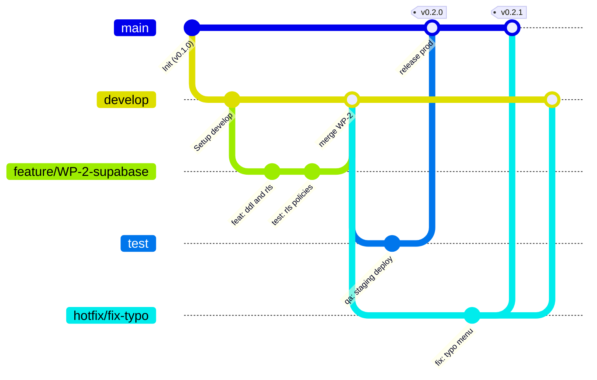

# Estrategia de Ramas GitFlow — Nexo ⚡

> **Documento:** Guía y Política de GitFlow para Nexo  
> **Autor:** Nexo-Tech-Lead (`nexo-tech-lead-mvvuxu9e`)  
> **Fecha:** 31 de Octubre de 2026  
> **Aprobado para:** Ciclo de Vida del Software y Despacho de Workers

---

## 1. Visión General del Flujo

Para garantizar estabilidad en producción, agilidad en desarrollo e idoneidad en las pruebas de calidad (QA), el desarrollo de Nexo se estructura en **tres ramas perennes principales** más ramas de soporte por tarea:



---

## 2. Definición de Ramas Principales

| Rama | Propósito | Entorno Asociado | Reglas de Protección |
| :--- | :--- | :--- | :--- |
| `main` | **Producción.** Contiene exclusivamente código verificado, estable y listo para usuarios finales. | Vercel Producción (`nexo.menu` o dominio público principal). | Protegida. Merge solo desde `test` (vía releases) o `hotfix/*`. Cada merge lleva tag semántico (`vX.Y.Z`). Prohibido push directo. |
| `test` | **Control de Calidad (QA) y Staging.** Validación de regresiones, pruebas E2E, calibración de benchmarks de IA y pruebas en mesa física con QR impreso. | Vercel Preview / Staging (`staging-nexo.vercel.app`). | Protegida. Merge solo desde `develop` o `release/*`. Ejecución de suites de prueba automáticas. |
| `develop` | **Desarrollo e Integración Continua.** Rama de convergencia para nuevas funcionalidades, paquetes de trabajo (WPs) y mejoras técnicas. | Vercel Dev Preview / Local (`localhost:3000`). | Protegida. Integración mediante Pull Requests validados desde `feature/*` o ramas de workers. |

---

## 3. Ramas de Trabajo y Nomenclatura

Las ramas temporales se crean para aislar cambios y se eliminan una vez integradas:

### 3.1. Ramas de Funcionalidad y Paquetes de Trabajo (`feature/*`)
* **Origen:** `develop`
* **Destino:** `develop`
* **Nomenclatura:** `feature/WP-<num>-<descripcion-corta>` (ejemplo: `feature/WP-2-supabase-rls`, `feature/WP-4-ai-benchmark`).
* **Uso:** Implementación de nuevos componentes, paquetes de trabajo del roadmap o mejoras de UX.

### 3.2. Ramas de Corrección Menor (`fix/*`)
* **Origen:** `develop`
* **Destino:** `develop`
* **Nomenclatura:** `fix/<descripcion>` (ejemplo: `fix/allergen-filter-toggle`, `fix/qr-print-margin`).

### 3.3. Ramas de Publicación / Release (`release/*`)
* **Origen:** `develop`
* **Destino:** `test` (para validación final) $\rightarrow$ luego `main` y sincronización con `develop`.
* **Nomenclatura:** `release/vX.Y.Z` (ejemplo: `release/v0.2.0`).
* **Uso:** Congelación de código previa a despliegue a producción; solo admite ajustes de documentación y bugfixes menores detectados en staging.

### 3.4. Ramas de Corrección Urgente en Producción (`hotfix/*`)
* **Origen:** `main`
* **Destino:** `main` (con nuevo tag de parche `vX.Y.Z+1`), `test` y `develop`.
* **Nomenclatura:** `hotfix/<descripcion-incidencia>` (ejemplo: `hotfix/critical-cors-header`).
* **Uso:** Errores críticos que impactan directamente a comensales o restaurantes en producción.

---

## 4. Integración del GitFlow con los Workers (Temps) del Hive

En la arquitectura de agentes autónomos del Hive:
1. **Despacho del Worker (Temp):**
   * El worker se inicializa con un git worktree aislado clonado a partir de la rama correspondiente (por defecto `develop`).
   * La rama del worker sigue el patrón: `worker-<id>/WP-<num>`.
2. **Revisión por el Tech Lead (`nexo-tech-lead`):**
   * El worker entrega su trabajo y reporta `done` al Tech Lead con el nombre de su rama.
   * El Tech Lead ejecuta verificación técnica (`npm run lint`, auditoría de seguridad y tests).
3. **Merge a `develop`:**
   * El Tech Lead realiza el merge hacia `develop` utilizando *Squash & Merge* o *Merge Commit* limpio para mantener un historial legible.
4. **Promoción a `test` y `main`:**
   * Una vez agrupados los paquetes en `develop`, se crea la rama de release y se mergea a `test` para pruebas de QA (WP-5).
   * Verificada la calidad, se realiza el merge a `main` con su respectivo tag de versión.

---

## 5. Convención de Commits (Conventional Commits)

Todos los commits deben respetar la especificación estándar:
`<tipo>(<ámbito opcional>): <descripción imperativa corta en minúsculas>`

### Tipos Permitidos:
* `feat`: Nueva funcionalidad para el hostelero o comensal.
* `fix`: Corrección de un fallo o bug.
* `docs`: Cambios exclusivos en documentación o especificaciones.
* `style`: Ajustes de formato, espaciados o CSS sin cambio de lógica de negocio.
* `refactor`: Refactorización de código sin añadir funcionalidades ni corregir fallos.
* `perf`: Mejora de rendimiento (ej. optimización de carga de imágenes o ISR).
* `test`: Adición o modificación de pruebas unitarias, de integración o benchmarks.
* `chore`: Mantenimiento de herramientas, dependencias o configuración del repositorio.

**Ejemplos:**
* `feat(menu): add reactive filter for 14 eu allergens in public menu`
* `fix(qr): prevent clipping when printing a5 tabletop stand`
* `test(ai): add benchmark suite for litert hybrid vs ollama`

---

## 6. Procedimiento Inmediato de Inicialización (Para WP-1)

El worker `worker-git-devops` en el paquete **WP-1** debe ejecutar la siguiente secuencia:
1. Limpiar el working tree y asegurar exclusión de `.next`, `.env*.local` en `.gitignore`.
2. Crear el commit fundacional en `main`:
   ```bash
   git add .
   git commit -m "feat: initial production-ready codebase for Nexo MVP"
   ```
3. Crear y cambiar a la rama `develop`:
   ```bash
   git checkout -b develop
   ```
4. Crear la rama `test` a partir de `develop`:
   ```bash
   git branch test
   ```
5. Dejar activa la rama `develop` como base para los paquetes de trabajo subsiguientes (`WP-2`, `WP-3`, `WP-4`, `WP-5`).
