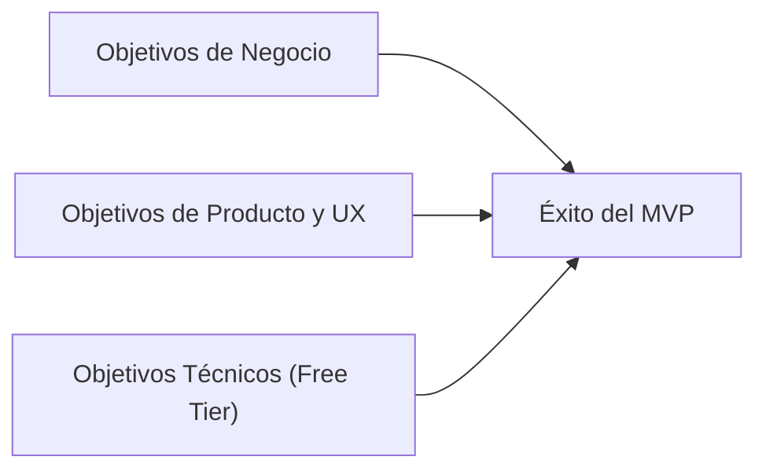
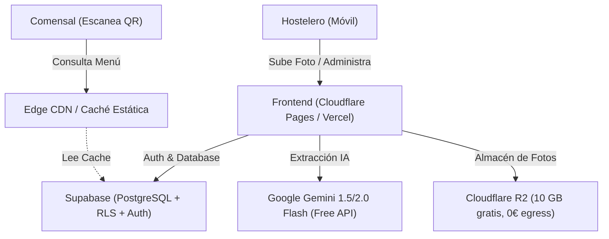
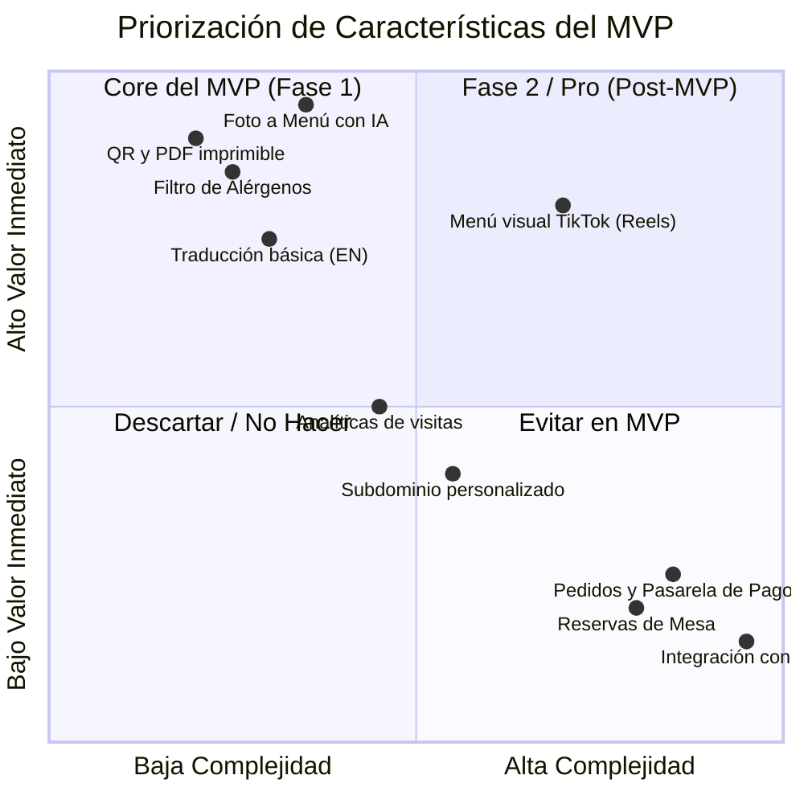
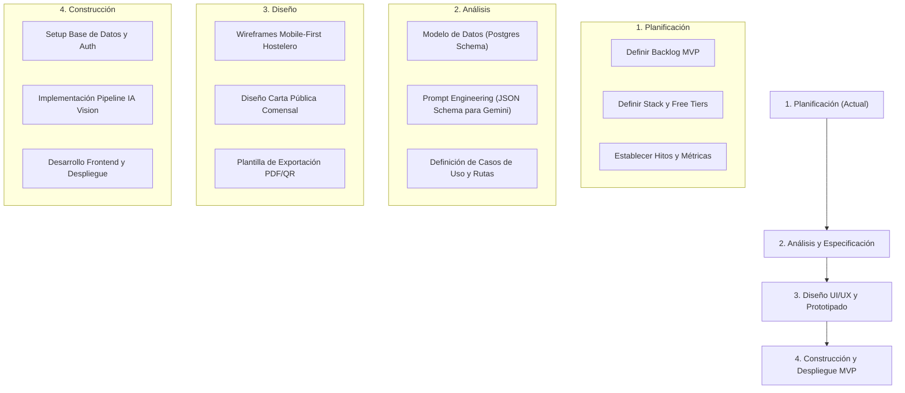

# Informe de Investigación: Objetivos y Requisitos para el MVP de Nexo

> **Proyecto:** Nexo (Micro-SaaS para Bares y Restaurantes Pequeños)  
> **Propuesta:** *"Tu restaurante en internet en 3 minutos con una foto"* por 1 €/mes (con Plan Free inicial).  
> **Fase:** Planificación Preliminar e Investigación de Requisitos.

---

## 1. Diagnóstico del Informe Actual (`Idea.md`)

El documento base identifica con precisión un nicho desatendido en el mercado español: la **micro-hostelería** (bares de barrio, cafeterías, hamburgueserías locales, kebabs, pizzerías familiares). Estos negocios no necesitan ni pueden costear ni operar plataformas complejas como *CoverManager*, *Flipdish* o *Last.app*.

### Factores Críticos Identificados:
1. **Fricción Cero en Onboarding:** El hostelero no va a escribir 40 platos a mano en un panel web complejo. El núcleo del producto es: **Foto de la carta en papel $\rightarrow$ Menú digital listo, categorizado, con alérgenos sugeridos y traducido.**
2. **Modelo de Coste Marginal Cercano a Cero:** Si el modelo comercial aspira a cobrar 1 €/mes (o mantener un Plan Free sostenible), el coste de servidor, base de datos e inteligencia artificial por local debe situarse en el rango de **0,02 € a 0,08 €/mes**.
3. **Restricción de Alcance Radical (Anti-Features):** Quedan rotundamente descartados para el MVP: delivery, reservas de mesa, pasarela de cobros en mesa, TPV/POS y CRM complejo.

---

## 2. Objetivos que Debemos Fijar

Para garantizar que el proyecto transite con éxito por las fases de **Planificación $\rightarrow$ Análisis $\rightarrow$ Diseño $\rightarrow$ Construcción**, establecemos tres categorías de objetivos:

### 2.1. Objetivos de Negocio y Validación
* **Time-to-Value (TTV) < 3 minutos:** Un propietario debe registrarse, fotografiar su pizarra o carta física y tener su menú público accesible vía QR en menos de 180 segundos.
* **Coste Operativo 0 € durante la fase de lanzamiento (MVP):** La infraestructura completa del MVP debe correr 100% sobre capas gratuitas (*Free Tiers*) de proveedores modernos sin generar gastos recurrentes fijos.
* **Conversión y Retención Orgánica:** Lograr que el Plan Free sea autosuficiente con marca de agua *"Creado con Nexo - Crea el tuyo gratis"*, actuando como vector viral entre otros hosteleros y comensales.

### 2.2. Objetivos de Producto y Experiencia (UX)
* **Precisión en la Ingesta por IA > 85%:** La extracción visual debe identificar correctamente secciones (Entrantes, Principales, Bebidas), platos y precios sin necesidad de reescritura manual masiva.
* **Detección Automática de Alérgenos (Normativa UE):** Asistir al hostelero sugiriendo los 14 alérgenos obligatorios de la UE según los ingredientes del plato.
* **Menú Público Ultra-Rápido (< 500 ms de carga):** El comensal que escanea el QR en un bar con cobertura móvil deficiente (3G/4G) debe ver la carta de inmediato sin pantallas de carga pesadas.
* **Diseño 'Mobile-First' Dual:**
  * *Panel Hostelero:* Operable al 100% desde un smartphone (el hostelero rara vez usa ordenador de sobremesa en el local).
  * *Vista Comensal:* Interfaz fluida, modo oscuro/claro, filtrado instantáneo por alérgenos y selector multiidioma (ES/EN/FR/DE).

### 2.3. Objetivos Técnicos y de Arquitectura
* **Cómputo en el Cliente (*Client-Side Compute*):** Generación de códigos QR (PNG, SVG) y PDFs para imprimir directamente en el navegador del cliente para consumir 0 segundos de CPU en backend.
* **Caché en el Edge / Static Delivery:** El menú público debe servirse como contenido estático cacheado en CDN. Si un restaurante recibe 5.000 escaneos de QR en un fin de semana, esto **no** debe realizar 5.000 consultas a la base de datos ni peticiones a la IA.
* **Ejecución IA Bajo Demanda Exclusiva:** La IA solo se ejecuta en la creación o actualización de la carta (coste puntual de 0,001 € a 0,003 € por extracción con Gemini Flash).

---

## 3. Requisitos Clave para Iniciar la Planificación

Antes de escribir código o diseñar pantallas, debemos satisfacer y documentar los siguientes requisitos:

### 3.1. Requisitos Funcionales del MVP (Plan Free)

| Módulo | Funcionalidad Requerida | Criterio de Aceptación |
| :--- | :--- | :--- |
| **Autenticación** | Registro ultra-simple (Magic Link / OTP / Google) | Sin contraseñas complejas; acceso con un toque desde móvil. |
| **Ingesta IA** | Subida de 1 a 3 fotos de la carta | Procesamiento multimodal estructurado (JSON Schema). |
| **Editor Rápido** | Pantalla de revisión táctil | El hostelero confirma/corrige precios, platos y alérgenos en < 1 min. |
| **Motor Alérgenos** | Marcado de los 14 alérgenos oficiales UE | Selector visual con iconos oficiales estandarizados. |
| **Generador QR** | Exportación de QR en PNG, SVG y plantilla imprimible | Plantilla PDF estándar para imprimir en A5/A6 con el logo/nombre. |
| **Carta Pública** | Mini-web responsive con selector de idioma y filtro | Ruta amigable (`nexo.menu/{slug}` o subdominio), carga instantánea. |

### 3.2. Requisitos Técnicos: Arquitectura "Zero Cost" (Plan Free)

Para garantizar viabilidad económica desde el día cero, seleccionamos herramientas con capas gratuitas permanentes y sin comisiones ocultas:

* **Frontend & Hosting:** **Cloudflare Pages** o **Vercel** (Tráfico ilimitado, SSL automático, despliegues continuos desde Git).
* **Base de Datos & Auth:** **Supabase** (Plan Free incluye PostgreSQL gestionado, 500 MB de datos, 50.000 usuarios activos mensuales, Row Level Security para multi-tenant seguro).
* **Almacenamiento de Imágenes:** **Cloudflare R2** (10 GB gratuitos al mes y lo más importante: **cero costes por transferencia de datos / egress**).
* **Motor de IA Multimodal:** **Gemini 2.0 Flash / 1.5 Flash (Google AI Studio)**:
  * Capa gratuita de alta tasa de peticiones (15 RPM en tier gratuito, más que suficiente para MVP).
  * Excelente comprensión en español y formatos tabulares complejos de cartas de restaurante.
  * Soporte nativo de *Structured Outputs* (garantiza devolver JSON válido según un schema estricto).

### 3.3. Requisitos Legales y Normativos (Mercado Español / UE)
1. **Reglamento (UE) Nº 1169/2011 sobre Información Alimentaria:**
   * La ley obliga a informar claramente sobre los **14 alérgenos principales** (gluten, crustáceos, huevos, pescado, cacahuetes, soja, lácteos, frutos de cáscara, apio, mostaza, sésamo, sulfitos, altramuces, moluscos).
   * **Requisito de Responsabilidad Legal:** En la interfaz de validación se debe incluir una cláusula explícita:  
     > *"La IA sugiere los alérgenos con fines de asistencia. El establecimiento es el único responsable legal de certificar la veracidad de los ingredientes y alérgenos servidos."*
2. **RGPD / LOPD-GDD:**
   * Política de privacidad y aviso legal simplificado.
   * La vista del comensal **no debe requerir cookies de rastreo**, permitiendo prescindir del molesto banner de cookies en la carta pública.

---

## 4. Matriz de Alcance: ¿Qué entra y qué NO en el MVP?

* **DENTRO del MVP (Plan Free):**
  * Ingesta de carta por foto con Gemini Flash.
  * Extracción automática estructurada (Categorías, Platos, Precios).
  * Sugerencia automática de los 14 alérgenos UE.
  * Editor interactivo rápido de validación.
  * Traducción automática (al menos Español e Inglés).
  * Generación y descarga de QR + plantilla PDF lista para imprimir.
  * Menú web público ultra-rápido (`nexo.menu/[slug]`).
* **FUERA del MVP (Reservado para Versiones Posteriores o Planes de Pago):**
  * Formato "TikTok / Reels" con vídeos (se requiere hosting y compresión de vídeo; aumentaría costes en Free Tier).
  * Pedidos online, delivery o pasarela Stripe.
  * Gestión de reservas o comandas.
  * TPV / Conexión con impresoras térmicas.

---

## 5. Hoja de Ruta Operativa: Planificación $\rightarrow$ Construcción

Para llevar la idea a producción de manera profesional, seguiremos este ciclo:

---

## 6. Decisiones Clave para Iniciar la Fase de Planificación

Para cerrar esta etapa e iniciar el **Análisis Funcional y Técnico**, necesitamos acordar los siguientes puntos:

1. **Framework Frontend Predilecto:**
   * *Next.js (App Router)*: Estándar para SSR/SSG, ideal si se despliega en Vercel.
   * *Astro + React/Svelte*: Extremadamente rápido para webs públicas, casi 0 KB de JavaScript en la carta del comensal, excelente despliegue en Cloudflare Pages.
2. **Estrategia de Dominio e Identidad:**
   * ¿Comenzamos con un subdominio gratuito temporal (ej. `nexo-menu.pages.dev` o `nexo.app`) o se dispondrá de un dominio propio (`.es` o `.com`)?
3. **Validación de la Característica "Menú tipo TikTok":**
   * ¿Confirmamos mantenerla como un *objetivo Fase 2 (Plan Pro)* para proteger el consumo del Free Tier en el MVP inicial?
