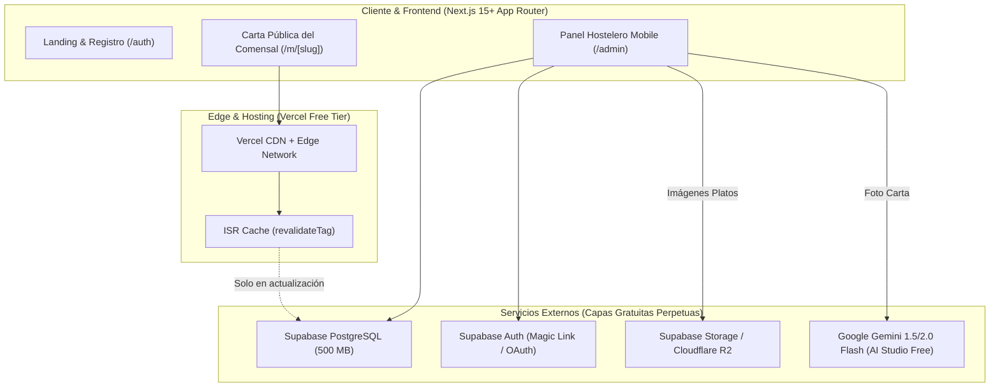
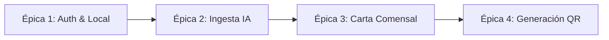
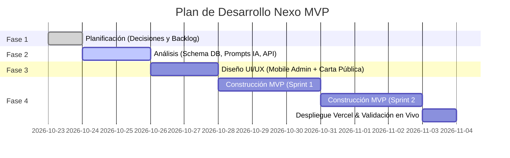

# Documento de Planificación del MVP: Nexo

> **Estado:** Aprobado para iniciar Fase de Análisis  
> **Framework:** Next.js (App Router, Server Actions, RSC)  
> **Despliegue & Dominio:** Vercel (Hobby Free Tier) con subdominio gratuito (`*.vercel.app`) y rutas amigables `/m/[slug]`  
> **Alcance:** MVP Core (Carta Inteligente con IA, Alérgenos UE, Multiidioma y QR).  
> **Fase 2 (Post-MVP):** Menú visual dinámico tipo TikTok/Reels (Plan Pro).

---

## 1. Decisiones Arquitectónicas Fundacionales

A partir de las definiciones acordadas, la arquitectura técnica queda estructurada para operar con **0 € de coste fijo** durante toda la fase de lanzamiento y validación.



### 1.1. Estrategia de Subdominio y Routing en Next.js
* **Dominio Base Inicial:** `nexo-menu.vercel.app` (100% gratuito con certificado SSL wildcard automático).
* **Ruta de la Carta:** `/m/[slug]` (ejemplo: `nexo-menu.vercel.app/m/bar-pepe`).
  * *Ventaja:* No requiere configuración DNS compleja ni soporte de dominios multi-tenant a nivel de servidor web en el MVP.
  * *Evolución futura:* Con Next.js Middleware es trivial pasar a `bar-pepe.nexo.menu` o dominio propio sin rehacer la lógica interna.
* **Caché Ultra-Eficiente con ISR (`revalidateTag`):**
  * La carta pública del comensal `/m/[slug]` se genera como página estática mediante **Incremental Static Regeneration (ISR)**.
  * Cuando el hostelero modifica un precio o plato en `/admin`, se invoca `revalidateTag('menu-[slug]')`.
  * **Impacto en costes:** 50.000 lecturas de QR al mes suponen **0 llamadas a la base de datos de Supabase**, sirviéndose directamente desde la memoria caché global de Vercel Edge.

---

## 2. Backlog Detallado del MVP (Épicas e Historias de Usuario)

El MVP se estructura en **4 Épicas Clave**, respetando la regla de máxima simplicidad y fricción cero.



### Épica 1: Autenticación y Configuración Rápida del Local
* **US-1.1: Acceso Sin Fricción (Passwordless)**
  * *Como* hostelero no técnico,  
  * *Quiero* registrarme solo con mi email (Magic Link) o con Google,  
  * *Para* no tener que recordar ni configurar contraseñas complejas desde el móvil.
* **US-1.2: Perfil Mínimo del Restaurante**
  * *Como* hostelero,  
  * *Quiero* definir el nombre de mi local, logo/avatar básico y slug personalizado,  
  * *Para* tener mi enlace único asignado inmediatamente (ej. `/m/el-rincon-de-pepe`).

---

### Épica 2: Ingesta Inteligente de Carta (Core Diferencial)
* **US-2.1: Captura y Compresión en Cliente**
  * *Como* hostelero,  
  * *Quiero* tomar 1 a 3 fotos de mi carta en papel o pizarra desde la app web,  
  * *Para* que se suba rápidamente incluso con conexión 3G/4G lenta (compresión automática en el navegador antes de enviar).
* **US-2.2: Extracción Estructurada con Gemini Flash**
  * *Como* sistema,  
  * *Quiero* enviar la imagen a Gemini Flash con un esquema JSON estricto (*Structured Outputs*),  
  * *Para* parsear con alta precisión: Nombre de la sección, Nombre del plato, Descripción y Precio (€).
* **US-2.3: Inferencia Automática de los 14 Alérgenos UE**
  * *Como* hostelero,  
  * *Quiero* que la IA detecte y pre-seleccione los alérgenos obligatorios de cada plato,  
  * *Para* cumplir la normativa europea (Reglamento 1169/2011) sin tener que buscarlos uno a uno en un manual.
* **US-2.4: Traducción Instantánea al Inglés**
  * *Como* hostelero en zona turística,  
  * *Quiero* que los títulos y descripciones se traduzcan automáticamente en el mismo proceso de guardado,  
  * *Para* atender a clientes extranjeros sin esfuerzo ni costes adicionales de traducción.
* **US-2.5: Editor Táctil de Verificación y Salvaguarda Legal**
  * *Como* hostelero,  
  * *Quiero* revisar visualmente en formato lista los platos extraídos, ajustar algún precio si es necesario y marcar *"Confirmo ingredientes y alérgenos"*,  
  * *Para* publicar la carta con total certeza y blindaje de responsabilidad.

---

### Épica 3: Experiencia del Comensal (Carta Pública Ultra-Ligera)
* **US-3.1: Carga Instantánea (< 500 ms)**
  * *Como* comensal que escanea el código en la mesa,  
  * *Quiero* que la carta aparezca al instante sin pantallas de carga ni banners invasivos,  
  * *Para* poder consultar los platos de inmediato sin frustración.
* **US-3.2: Filtro Interactivo por Alérgenos**
  * *Como* comensal celíaco o alérgico a la lactosa/frutos secos,  
  * *Quiero* filtrar la carta para ocultar los platos no aptos o resaltar los seguros,  
  * *Para* comer con total tranquilidad.
* **US-3.3: Cambio de Idioma en 1 Clic**
  * *Como* turista extranjero,  
  * *Quiero* alternar entre Español e Inglés en tiempo real sin recargar la página,  
  * *Para* entender la oferta gastronómica en mi idioma.
* **US-3.4: Sello Viral del Plan Free**
  * *Como* plataforma Nexo,  
  * *Quiero* incluir un pie discreto pero visible: *"Carta creada con Nexo · Crea la tuya gratis"*,  
  * *Para* generar captación orgánica de nuevos clientes de forma pasiva.

---

### Épica 4: Generación y Descarga de Material Físico (QR)
* **US-4.1: Generación de QR en Navegador (Cero Cómputo Servidor)**
  * *Como* hostelero,  
  * *Quiero* descargar el QR en formato PNG y SVG en alta resolución,  
  * *Para* enviarlo a mi imprenta o usarlo en mis redes sociales.
* **US-4.2: Plantilla PDF Imprimible Lista para Mesa**
  * *Como* hostelero sin diseñador gráfico,  
  * *Quiero* descargar un PDF listo para imprimir en tamaño A5 o formato peana de mesa con el QR centrado y el nombre de mi local,  
  * *Para* imprimirlo en mi impresora estándar y colocarlo en las mesas de inmediato.

---

## 3. Arquitectura del Proyecto en Next.js (Estructura de Directorios)

```
nexo/
├── app/
│   ├── (marketing)/
│   │   ├── page.tsx               # Landing page con CTA de registro
│   │   └── layout.tsx
│   ├── (auth)/
│   │   ├── login/page.tsx         # Magic Link / Google Sign-in
│   │   └── callback/route.ts      # Callback de Supabase Auth
│   ├── admin/
│   │   ├── layout.tsx             # Layout protegido con barra de navegación móvil
│   │   ├── page.tsx               # Dashboard: resumen y estado de la carta
│   │   ├── onboarding/
│   │   │   └── page.tsx           # Asistente: subir foto -> procesando -> validar
│   │   ├── menu/
│   │   │   └── page.tsx           # Gestor y editor rápido de platos/secciones
│   │   └── qr/
│   │       └── page.tsx           # Descarga de QR y generador de plantilla PDF
│   ├── m/
│   │   └── [slug]/
│   │       ├── page.tsx           # Carta pública (SSR + ISR con revalidateTag)
│   │       └── layout.tsx         # Layout limpio sin navbar de app (ultra-rápido)
│   ├── api/
│   │   └── ai/
│   │       └── extract-menu/      # Route Handler para llamada segura a Gemini Flash
│   └── globals.css
├── components/
│   ├── ui/                        # Botones, inputs, badges, diálogos accesibles
│   ├── admin/                     # Componentes del editor táctil, cámara/dropzone
│   ├── menu/                      # Componentes de la carta pública, filtros alérgenos
│   └── qr/                        # Generador cliente de QR y renderizador PDF
├── lib/
│   ├── supabase/                  # Clientes Supabase (browser, server, middleware)
│   ├── gemini/                    # Cliente Google AI Studio y schema JSON de salida
│   └── allergens.ts               # Constantes de los 14 alérgenos UE con iconos SVG
└── middleware.ts                  # Protección de rutas /admin y resolución de slugs
```

---

## 4. Estrategia de Consumo y Salvaguardas Free Tier

| Servicio | Límite Free Tier | Estrategia Nexo MVP | Riesgo de Superación |
| :--- | :--- | :--- | :--- |
| **Vercel** | 100 GB ancho de banda / mes | Menú público estático ultra-comprimido (< 150 KB por carga). | **Casi nulo** (equivale a ~600.000 lecturas/mes). |
| **Supabase DB** | 500 MB PostgreSQL | Esquema relacional optimizado. 1 restaurante medio = ~50 KB de datos. | **Cero** (soporta ~5.000 restaurantes en free tier). |
| **Supabase Auth** | 50.000 MAU | Autenticación solo para hosteleros (los comensales no se autentican). | **Cero**. |
| **Cloudflare R2** | 10 GB storage / 0 € egress | Fotos originales de cartas e imágenes de platos. Egress ilimitado gratuito. | **Cero**. |
| **Gemini Flash** | 15 peticiones / min (Gratis) | 1 llamada por escaneo de carta completa. Límite de 3 intentos/día por local. | **Blindado** mediante rate limiting en backend. |

---

## 5. Hitos y Cronograma Hacia las Siguientes Fases



### Próximo Paso Inmediato:
Iniciar la **Fase 2: Análisis y Especificación Técnica**, que generará:
1. Esquema relacional de base de datos en PostgreSQL (Tablas `restaurants`, `categories`, `dishes`, `dish_allergens`).
2. Contrato de datos y especificación del Prompt para Gemini Flash con JSON Schema.
3. Especificación detallada de Server Actions y Route Handlers en Next.js.
