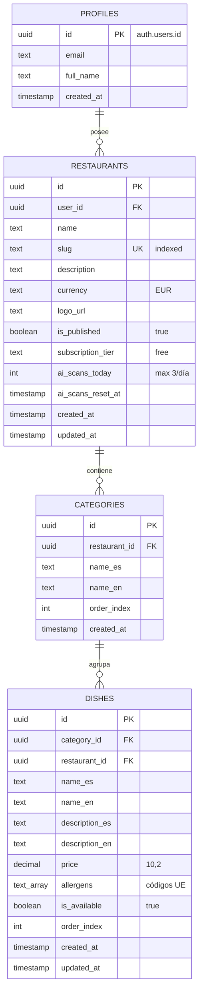
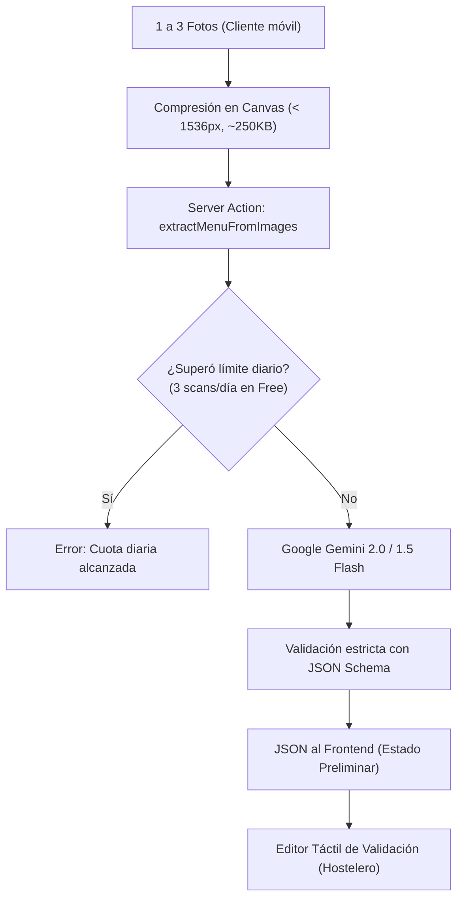
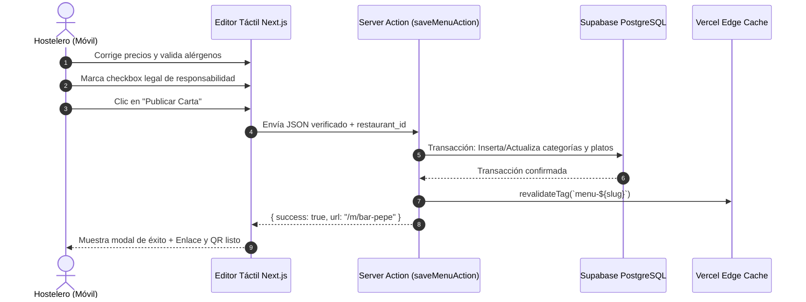

# Fase 2: Análisis y Especificación Técnica del MVP

> **Proyecto:** Nexo  
> **Fase:** 2 - Análisis y Especificación Técnica  
> **Objetivo:** Definir la arquitectura de datos, el contrato del pipeline de IA, los flujos de Server Actions en Next.js y las salvaguardas de seguridad y cumplimiento legal.

---

## 1. Modelo de Datos Relacional (PostgreSQL / Supabase)

El modelo está optimizado para **mínimo consumo de almacenamiento** (< 50 KB por restaurante), velocidad de lectura estática y **aislamiento estricto multi-tenant** mediante *Row Level Security* (RLS).



### 1.1. Script DDL Completo para Supabase (SQL)

```sql
-- 1. Habilitar extensiones necesarias
CREATE EXTENSION IF NOT EXISTS "uuid-ossp";

-- 2. Tabla de Restaurantes
CREATE TABLE public.restaurants (
    id UUID PRIMARY KEY DEFAULT uuid_generate_v4(),
    user_id UUID REFERENCES auth.users(id) ON DELETE CASCADE NOT NULL,
    name TEXT NOT NULL,
    slug TEXT NOT NULL UNIQUE,
    description TEXT,
    currency VARCHAR(3) DEFAULT 'EUR' NOT NULL,
    logo_url TEXT,
    is_published BOOLEAN DEFAULT TRUE NOT NULL,
    subscription_tier TEXT DEFAULT 'free' CHECK (subscription_tier IN ('free', 'starter', 'pro')),
    ai_scans_today INT DEFAULT 0 NOT NULL,
    ai_scans_reset_at TIMESTAMPTZ DEFAULT NOW() NOT NULL,
    created_at TIMESTAMPTZ DEFAULT NOW() NOT NULL,
    updated_at TIMESTAMPTZ DEFAULT NOW() NOT NULL
);

-- Índice para búsquedas ultra-rápidas por slug en la carta pública
CREATE INDEX idx_restaurants_slug ON public.restaurants(slug);
CREATE INDEX idx_restaurants_user_id ON public.restaurants(user_id);

-- 3. Tabla de Categorías (Secciones de la carta)
CREATE TABLE public.categories (
    id UUID PRIMARY KEY DEFAULT uuid_generate_v4(),
    restaurant_id UUID REFERENCES public.restaurants(id) ON DELETE CASCADE NOT NULL,
    name_es TEXT NOT NULL,
    name_en TEXT,
    order_index INT DEFAULT 0 NOT NULL,
    created_at TIMESTAMPTZ DEFAULT NOW() NOT NULL
);

CREATE INDEX idx_categories_restaurant_order ON public.categories(restaurant_id, order_index);

-- 4. Tabla de Platos
CREATE TABLE public.dishes (
    id UUID PRIMARY KEY DEFAULT uuid_generate_v4(),
    restaurant_id UUID REFERENCES public.restaurants(id) ON DELETE CASCADE NOT NULL,
    category_id UUID REFERENCES public.categories(id) ON DELETE CASCADE NOT NULL,
    name_es TEXT NOT NULL,
    name_en TEXT,
    description_es TEXT,
    description_en TEXT,
    price DECIMAL(10, 2) NOT NULL,
    allergens TEXT[] DEFAULT '{}'::TEXT[] NOT NULL,
    is_available BOOLEAN DEFAULT TRUE NOT NULL,
    order_index INT DEFAULT 0 NOT NULL,
    created_at TIMESTAMPTZ DEFAULT NOW() NOT NULL,
    updated_at TIMESTAMPTZ DEFAULT NOW() NOT NULL
);

CREATE INDEX idx_dishes_category_order ON public.dishes(category_id, order_index);
CREATE INDEX idx_dishes_restaurant ON public.dishes(restaurant_id);

-- 5. Configuración de Row Level Security (RLS)
ALTER TABLE public.restaurants ENABLE ROW LEVEL SECURITY;
ALTER TABLE public.categories ENABLE ROW LEVEL SECURITY;
ALTER TABLE public.dishes ENABLE ROW LEVEL SECURITY;

-- Políticas de RESTAURANTS:
-- A) Lectura pública si está publicado
CREATE POLICY "Public read for published restaurants"
    ON public.restaurants FOR SELECT
    USING (is_published = true);

-- B) Gestión total para el propietario
CREATE POLICY "Owners manage their restaurants"
    ON public.restaurants FOR ALL
    USING (auth.uid() = user_id)
    WITH CHECK (auth.uid() = user_id);

-- Políticas de CATEGORIES:
-- A) Lectura pública vinculada a restaurante publicado
CREATE POLICY "Public read categories"
    ON public.categories FOR SELECT
    USING (
        EXISTS (
            SELECT 1 FROM public.restaurants r 
            WHERE r.id = categories.restaurant_id AND r.is_published = true
        )
    );

-- B) Gestión para el propietario
CREATE POLICY "Owners manage categories"
    ON public.categories FOR ALL
    USING (
        EXISTS (
            SELECT 1 FROM public.restaurants r 
            WHERE r.id = categories.restaurant_id AND r.user_id = auth.uid()
        )
    );

-- Políticas de DISHES:
-- A) Lectura pública de platos disponibles en restaurantes publicados
CREATE POLICY "Public read dishes"
    ON public.dishes FOR SELECT
    USING (
        EXISTS (
            SELECT 1 FROM public.restaurants r 
            WHERE r.id = dishes.restaurant_id AND r.is_published = true
        )
    );

-- B) Gestión para el propietario
CREATE POLICY "Owners manage dishes"
    ON public.dishes FOR ALL
    USING (
        EXISTS (
            SELECT 1 FROM public.restaurants r 
            WHERE r.id = dishes.restaurant_id AND r.user_id = auth.uid()
        )
    );
```

---

## 2. Pipeline de Ingesta IA (Gemini Flash Vision)

Para garantizar consistencia y 0 errores en frontend, la inferencia utiliza **Structured Outputs** mediante `response_schema`.



### 2.1. Catálogo Estandarizado de los 14 Alérgenos UE (Reglamento 1169/2011)

Se emplean códigos en formato `snake_case` inmutables:

| Código Técnico | Nombre (ES) | Name (EN) | Icono Sugerido |
| :--- | :--- | :--- | :--- |
| `gluten` | Gluten (Trigo, centeno, cebada, avena) | Gluten | 🌾 Trigo |
| `crustaceans` | Crustáceos (Gambas, langostinos, cangrejos) | Crustaceans | 🦐 Gamba |
| `eggs` | Huevos | Eggs | 🥚 Huevo |
| `fish` | Pescado | Fish | 🐟 Pescado |
| `peanuts` | Cacahuetes | Peanuts | 🥜 Cacahuete |
| `soybeans` | Soja | Soybeans | 🌱 Soja |
| `dairy` | Leche y derivados (Lactosa) | Milk / Dairy | 🥛 Leche |
| `nuts` | Frutos de cáscara (Almendras, nueces, avellanas) | Tree Nuts | 🌰 Nuez |
| `celery` | Apio | Celery | 🥬 Apio |
| `mustard` | Mostaza | Mustard | 🌭 Mostaza |
| `sesame` | Sésamo | Sesame seeds | 🥯 Sésamo |
| `sulphites` | Sulfitos / Dióxido de azufre (Vinos, vinagres) | Sulphites | 🍷 Vino/Sulfitos |
| `lupin` | Altramuces | Lupin | 🌼 Altramuz |
| `molluscs` | Moluscos (Mejillones, calamares, pulpo) | Molluscs | 🐙 Molusco |

### 2.2. Definición del Prompt de Sistema y Esquema JSON

```typescript
// lib/gemini/prompt.ts

export const GEMINI_MENU_EXTRACTION_SYSTEM_PROMPT = `
Eres un sumiller y jefe de cocina profesional experto en digitalización de cartas de hostelería española y cumplimiento del Reglamento (UE) Nº 1169/2011 de alérgenos.

Tu tarea es analizar una o varias imágenes de cartas físicas, pizarras o menús y extraer de forma estructurada todas las categorías y platos.

REGLAS DE EXTRACCIÓN:
1. Agrupa los platos en sus categorías lógicas (ej. 'Tapas y Raciones', 'Ensaladas', 'Carnes', 'Bebidas', 'Postres').
2. Corrige faltas ortográficas evidentes pero preserva el nombre gastronómico tradicional.
3. Precios: Extrae el valor numérico exacto en euros (número flotante, ej. 8.50). Si no tiene precio o es "según mercado", pon 0.
4. Alérgenos obligatorios de la UE: Asigna ÚNICAMENTE los códigos del siguiente listado si los ingredientes del plato típicamente los contienen o se mencionan:
   ['gluten', 'crustaceans', 'eggs', 'fish', 'peanuts', 'soybeans', 'dairy', 'nuts', 'celery', 'mustard', 'sesame', 'sulphites', 'lupin', 'molluscs'].
   Ante la duda razonable en recetas tradicionales españolas (ej. croquetas contienen gluten y dairy; tortilla contiene eggs), inclúyelos.
5. Traducción al inglés: Traduce con precisión natural para turistas el nombre y la descripción de cada plato y categoría.
`;

export const GEMINI_RESPONSE_SCHEMA = {
  type: "OBJECT",
  properties: {
    categories: {
      type: "ARRAY",
      items: {
        type: "OBJECT",
        properties: {
          name_es: { type: "STRING" },
          name_en: { type: "STRING" },
          dishes: {
            type: "ARRAY",
            items: {
              type: "OBJECT",
              properties: {
                name_es: { type: "STRING" },
                name_en: { type: "STRING" },
                description_es: { type: "STRING" },
                description_en: { type: "STRING" },
                price: { type: "NUMBER" },
                allergens: {
                  type: "ARRAY",
                  items: { type: "STRING" }
                }
              },
              required: ["name_es", "price", "allergens"]
            }
          }
        },
        required: ["name_es", "dishes"]
      }
    }
  },
  required: ["categories"]
};
```

---

## 3. Especificación de Server Actions y Flujos en Next.js

Para mantener la aplicación moderna y segura, el 100% de las mutaciones se realizan mediante **Server Actions** de Next.js protegidas por sesión de Supabase.



### 3.1. Catálogo de Server Actions del MVP

| Server Action | Archivo | Parámetros de Entrada | Acción Ejecutada |
| :--- | :--- | :--- | :--- |
| `extractMenuAction` | `app/actions/ai.ts` | `FormData` (fotos en base64 o buffers) | Valida rate limit diario, invoca Gemini Flash, retorna JSON para preview. |
| `saveMenuAction` | `app/actions/menu.ts` | `MenuInputSchema` (Zod) | Guarda categorías y platos en transacción, revalida tag ISR `menu-[slug]`. |
| `updateDishAction` | `app/actions/menu.ts` | `id, price, name_es, allergens, is_available` | Edición puntual inline de un plato desde el móvil sin re-escanear. |
| `toggleDishAvailabilityAction`| `app/actions/menu.ts` | `dishId, isAvailable` | Switch rápido *"Agotado hoy"* para servicio en vivo. |
| `checkSlugAvailabilityAction` | `app/actions/restaurant.ts` | `slug: string` | Valida en tiempo real que el subdominio/slug no esté ocupado. |

---

## 4. Estrategia de Caché y Rendimiento (Vista Comensal)

La ruta `/m/[slug]` es el escaparate público del restaurante. Debe soportar miles de visitas concurrentes sin coste:

```typescript
// app/m/[slug]/page.tsx (Concepto de implementación)
import { notFound } from 'next/navigation';
import { getPublicMenuBySlug } from '@/lib/data/menu';
import { MenuPublicView } from '@/components/menu/MenuPublicView';

// Revalidación bajo demanda: Solo se regenera cuando cambia la carta
export const revalidate = false; // Basado en revalidateTag('menu-[slug]')

export async function generateMetadata({ params }: { params: { slug: string } }) {
  const restaurant = await getPublicMenuBySlug(params.slug);
  if (!restaurant) return {};

  return {
    title: `${restaurant.name} | Carta Digital`,
    description: restaurant.description || `Consulta la carta y alérgenos de ${restaurant.name}`,
    openGraph: {
      title: restaurant.name,
      images: [restaurant.logo_url || '/og-default.png'],
    },
  };
}

export default async function PublicMenuPage({ params }: { params: { slug: string } }) {
  const menuData = await getPublicMenuBySlug(params.slug);
  if (!menuData) notFound();

  return <MenuPublicView data={menuData} />;
}
```

### Principio de Invalidador Atómico:
Cuando el hostelero guarda en `/admin`, se ejecuta:
```typescript
import { revalidateTag } from 'next/cache';

// Invalida instantáneamente la caché edge del restaurante en Vercel
revalidateTag(`menu-${restaurant.slug}`);
```

---

## 5. Medidas de Seguridad, Rate Limiting y Blindaje Legal

1. **Blindaje de Responsabilidad Alimentaria:**
   * La interfaz de validación deshabilitará el botón *"Publicar Carta"* hasta que el hostelero marque obligatoriamente:
     > `[X] Confirmo que he verificado los ingredientes, precios y alérgenos de cada plato. Reconozco que la IA actúa únicamente como asistente y asumo la responsabilidad legal ante los clientes.`
2. **Rate Limiting Preventivo en Free Tier:**
   * Cada restaurante en Plan Free tiene un cupo de **3 escaneos de IA al día** (almacenado en `restaurants.ai_scans_today`, reiniciado automáticamente a las 00:00 UTC).
   * Tamaño máximo por imagen: 5 MB (con pre-compresión obligatoria en el navegador antes de la subida a ~250 KB).
3. **Multi-Tenant Seguro sin Fugas de Datos:**
   * Todas las operaciones de base de datos en Supabase utilizan **Row Level Security (RLS)** evaluando `auth.uid() = user_id`, impidiendo que un hostelero acceda o modifique platos de otro restaurante.
