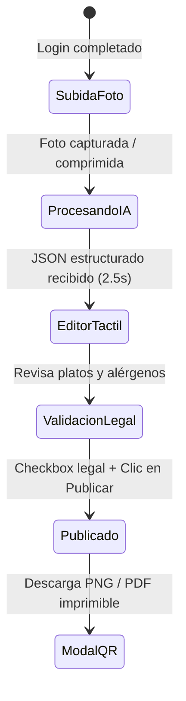
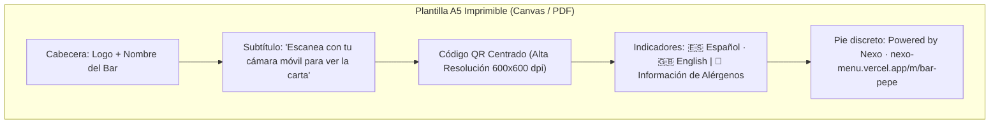

# Fase 3: Diseño UI/UX y Prototipado del MVP

> **Proyecto:** Nexo  
> **Fase:** 3 - Diseño UI/UX y Prototipado  
> **Objetivo:** Definir la experiencia de usuario (UX), los flujos de interacción mobile-first, el sistema de diseño (Design Tokens) y los wireframes detallados para el hostelero y el comensal.

---

## 1. Principios de Diseño y Sistema Visual (Design System)

La micro-hostelería demanda una interfaz con **curva de aprendizaje cero**. El hostelero debe poder configurar su carta en el móvil entre servicio y servicio sin frustración.

### 1.1. Principios de UX
1. **Mobile-First Radical en Admin:** El 95% de los dueños de bares no usan PC en el local; toda la experiencia de gestión se diseña para interacción con una sola mano (zonas táctiles en el pulgar, botones de mínimo 48x48 px).
2. **Claridad Inmediata para el Comensal:** El comensal que escanea el QR tiene hambre y poca paciencia; la carta debe mostrar los platos inmediatamente sin menús hamburguesa obligatorios ni intros animadas innecesarias.
3. **Seguridad Alimentaria Visible:** Los alérgenos no son un pie de página escondido; disponen de iconografía oficial clara y filtros interactivos instantáneos.

### 1.2. Design Tokens (Tailwind CSS)

```typescript
// Configuración de tokens visuales
export const themeColors = {
  // Fondos y Superficies
  background: {
    light: '#FAFAFA',      // Neutral 50 (fondo limpio papel)
    dark: '#09090B',       // Zinc 950 (fondo OLED profundo)
  },
  surface: {
    light: '#FFFFFF',      // Blanco puro para tarjetas
    dark: '#18181B',       // Zinc 900 para tarjetas comensal
    muted: '#F4F4F5',      // Zinc 100 para controles secundarios
  },
  // Color de Marca y Acento Gastronómico
  brand: {
    primary: '#D97706',    // Amber 600 (cálido, apetecible, alta visibilidad)
    primaryHover: '#B45309',
    accent: '#059669',     // Emerald 600 (para confirmaciones y platos aptos)
  },
  // Tipografía
  text: {
    primary: '#18181B',    // Zinc 900
    secondary: '#71717A',  // Zinc 500
    inverse: '#FFFFFF',
  },
  // Estados y Alérgenos
  status: {
    available: '#10B981',  // Verde esmeralda
    soldOut: '#EF4444',    // Rojo apagado
    allergenWarning: '#F59E0B', // Ámbar aviso
  }
};
```

---

## 2. Flujo y Wireframes del Hostelero (Mobile-First Admin)



### 2.1. Pantalla 1: Asistente de Ingesta (Subida de Foto)
Diseñada para accionarse directamente desde la cámara del smartphone o galería:

```text
+---------------------------------------------------+
|  [Nexo]                              [Mi Perfil]  |
+---------------------------------------------------+
|                                                   |
|  ¡Convierte tu carta física en digital!           |
|  Haz una foto a tu menú en papel o pizarra.       |
|                                                   |
|  +---------------------------------------------+  |
|  |                                             |  |
|  |           [ Icono Cámara Grande ]           |  |
|  |                                             |  |
|  |         TOCA PARA HACER FOTO                |  |
|  |      o selecciona desde tu galería          |  |
|  |                                             |  |
|  |    (Soporta hasta 3 fotos: Cara A y B)      |  |
|  +---------------------------------------------+  |
|                                                   |
|  [ Miniatura 1 [X] ]  [ + Añadir otra cara ]       |
|                                                   |
|  ℹ️ Nuestro motor IA extraerá platos, precios     |
|     y detectará alérgenos de la UE al instante.   |
|                                                   |
|  +---------------------------------------------+  |
|  |   [ BOTÓN PRIMARIO: PROCESAR CON IA (2) ]   |  |
|  +---------------------------------------------+  |
+---------------------------------------------------+
```

### 2.2. Pantalla 2: Stepper de Procesamiento IA
Micro-interacción informativa para reducir la percepción de espera (2 a 3 segundos):

```text
+---------------------------------------------------+
|                                                   |
|                 [ Spinner Ámbar ]                 |
|                                                   |
|              Analizando tu carta...               |
|                                                   |
|   (✓) Leyendo fotos y corrigiendo textos          |
|   (✓) Extrayendo secciones y precios en €         |
|   (⏳) Identificando los 14 alérgenos de la UE...  |
|   ( ) Traduciendo platos al inglés                |
|                                                   |
|        "Casi listo. Solo tendrás que revisar"     |
+---------------------------------------------------+
```

### 2.3. Pantalla 3: Editor Táctil de Verificación Rápida
Permite al hostelero corregir con un toque cualquier plato o alérgeno antes de publicar:

```text
+---------------------------------------------------+
|  < Reintentar         EDITAR CARTA        [Guardar] |
+---------------------------------------------------+
|  CATEGORÍA: [ Tapas y Raciones ✏️ ]   [+ Categoría] |
|                                                   |
|  +---------------------------------------------+  |
|  |  Croquetas de Jamón Ibérico                 |  |
|  |  Precio: [ 9.50 ] €          [Disponible ✓] |  |
|  |  Alérgenos detectados:                       |  |
|  |  [🌾 Gluten x] [🥛 Lácteos x] [🥚 Huevo x]   |  |
|  |  [+ Añadir alérgeno]                        |  |
|  |  Traducción: "Iberian Ham Croquettes"       |  |
|  +---------------------------------------------+  |
|                                                   |
|  +---------------------------------------------+  |
|  |  Bravas de la Casa                          |  |
|  |  Precio: [ 6.00 ] €          [Disponible ✓] |  |
|  |  Alérgenos: [🌾 Gluten x]                    |  |
|  +---------------------------------------------+  |
|                                                   |
|  [+ Añadir nuevo plato en esta sección]           |
|                                                   |
|  -----------------------------------------------  |
|  CATEGORÍA: [ Carnes y Hamburguesas ✏️ ]           |
|  ...                                              |
|                                                   |
|  +---------------------------------------------+  |
|  | [X] CERTIFICACIÓN LEGAL OBLIGATORIA:        |  |
|  | Confirmo que los ingredientes y alérgenos   |  |
|  | mostrados son correctos. La IA es solo guía.|  |
|  +---------------------------------------------+  |
|                                                   |
|  +---------------------------------------------+  |
|  |  [ BOTÓN FIJO EN BASE: PUBLICAR CARTA YA ]  |  |
|  +---------------------------------------------+  |
+---------------------------------------------------+
```

---

## 2. Experiencia del Comensal: Carta Pública (`/m/[slug]`)

La vista pública está optimizada para **navegación rápida en mesa** sin requerir descarga de apps ni registro.

### 3.1. Wireframe de la Carta Pública
```text
+---------------------------------------------------+
|  BAR PEPE                    [ 🇪🇸 ES | 🇬🇧 EN ] [🌙] |
|  Cervecería & Tapas de barrio                      |
+---------------------------------------------------+
|  BARRA STICKY DE ALÉRGENOS (Desplazamiento horizontal): |
|  [🚫 Sin Gluten] [🥛 Sin Lactosa] [🥜 Sin Frutos] |
+---------------------------------------------------+
|  PESTAÑAS SECCIONES (Sticky con scroll-spy):       |
|  [ Tapas* ]   [ Raciones ]   [ Hamburguesas ] [..]|
+---------------------------------------------------+
|                                                   |
|  TAPAS Y RACIONES                                 |
|                                                   |
|  Croquetas de Jamón Ibérico              9,50 €   |
|  Bechamel cremosa con jamón de bellota            |
|  (🌾 Gluten) (🥛 Lácteos) (🥚 Huevos)             |
|  -----------------------------------------------  |
|  Patatas Bravas de la Casa               6,00 €   |
|  Salsa brava artesanal con toque ahumado          |
|  (🌾 Gluten)                                      |
|  -----------------------------------------------  |
|  Ensaladilla Rusa                        7,50 €   |
|  [ AGOTADO HOY ]                                  |
|  (🥚 Huevos) (🐟 Pescado)                         |
|                                                   |
|  CARNES Y PARRILLA                                |
|  ...                                              |
|                                                   |
|  -----------------------------------------------  |
|  ℹ️ Si tienes alguna alergia severa, avisa a      |
|     nuestro personal de sala al pedir.            |
|                                                   |
|  ⚡ Carta digital creada con Nexo                 |
|  [ ¿Tienes un bar? Crea tu menú gratis en 3 min ] |
+---------------------------------------------------+
```

### 3.2. Micro-interacción: Filtrado de Alérgenos en Mesa
Cuando el comensal pulsa el filtro `[🚫 Sin Gluten]`:
* Los platos que contienen gluten se atenúan suavemente o se ocultan con animación fluida.
* Se muestra un contador: *"Mostrando 18 platos sin gluten"*.
* Si un plato tiene trazas advertidas, se resalta con badge ámbar.

---

## 4. Diseño del Material Imprimible (Plantilla QR PDF de Mesa)

Para que el hostelero pueda imprimir inmediatamente su QR sin contratar a una imprenta, el generador cliente crea un documento en formato **A5 estándar (148 x 210 mm)** o formato **peana vertical plegable**:



### 4.1. Maqueta Visual de la Plantilla Imprimible
```text
+---------------------------------------------------+
|                                                   |
|                    BAR EL PASO                    |
|                                                   |
|        ESCANEA CON LA CÁMARA DE TU MÓVIL          |
|         PARA VER NUESTRA CARTA COMPLETA           |
|                                                   |
|             +-----------------------+             |
|             |  #####       #####    |             |
|             |  #   #  ###  #   #    |             |
|             |  #####  # #  #####    |             |
|             |         ###           |             |
|             |  #####  ###  #   #    |             |
|             |  #   #  #    ## ##    |             |
|             |  #####  ###  # # #    |             |
|             +-----------------------+             |
|                                                   |
|          🇪🇸 Español   ·   🇬🇧 English              |
|        🌾 Con información de los 14 alérgenos     |
|                                                   |
|             Wifi Clientes: BarPaso2026            |
|                                                   |
|  nexo-menu.vercel.app/m/bar-el-paso               |
|  -----------------------------------------------  |
|  Carta digital creada con Nexo                    |
+---------------------------------------------------+
```

---

## 5. Árbol de Componentes Frontend (Next.js & React)

```
components/
├── ui/
│   ├── Button.tsx                 # Estados default, loading, disabled
│   ├── Badge.tsx                  # Pills de alérgenos y precios
│   ├── Checkbox.tsx               # Checkbox accesible para confirmación legal
│   └── Dialog.tsx                 # Modal para añadir alérgenos o platos
├── admin/
│   ├── ImageUploader.tsx          # Dropzone + compresión con Canvas API
│   ├── AiProgressStepper.tsx      # Indicador de progreso de 4 pasos
│   ├── MenuEditorList.tsx         # Contenedor de categorías colapsables
│   ├── DishEditableCard.tsx       # Edición inline de plato, precio y alérgenos
│   └── AllergenSelectorModal.tsx  # Matriz de 14 alérgenos oficiales con iconos
├── menu/
│   ├── MenuHeader.tsx             # Nombre, logo, selector de idioma y modo oscuro
│   ├── AllergenFilterBar.tsx      # Barra táctil horizontal con badges de filtro
│   ├── SectionNavTabs.tsx         # Pestañas sticky con scroll-spy
│   ├── DishItem.tsx               # Tarjeta de plato con alérgenos destacados
│   └── NexoFooterBadge.tsx        # Marca de agua viral del Plan Free
└── qr/
    ├── QrCodeCanvas.tsx           # Renderizado de QR en SVG/PNG con qrcode.react
    └── PrintablePdfTemplate.tsx   # Documento PDF maquetado con @react-pdf/renderer
```

---

## 6. Criterios de Aceptación UI/UX para Construcción (DoD)

1. **Rendimiento Comensal (Core Web Vitals):**
   * Largest Contentful Paint (LCP) < 0,8 segundos en redes 4G simuladas.
   * Cumulative Layout Shift (CLS) = 0 (la barra de categorías y cabecera tienen alturas reservadas).
2. **Accesibilidad (a11y):**
   * Contraste tipográfico superior a 4.5:1 (WCAG AA).
   * Los alérgenos no se identifican únicamente por color; siempre incluyen texto e icono descriptivo.
3. **Ergonomía Táctil:**
   * Botones de acción principales (Guardar, Publicar, Subir) anclados en la zona inferior (*thumb zone*) del móvil.
