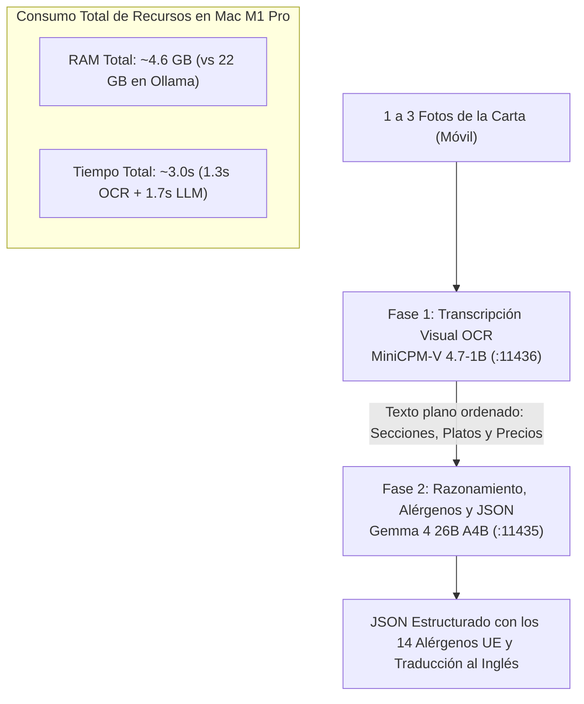

# Ingesta IA en Local: Pipeline Híbrido LiteRT-LM, Ollama y LLM_Local_Setup

> **Proyecto:** Nexo  
> **Referencia:** Benchmark y configuraciones de [JonyDevProjects/LLM_Local_Setup](https://github.com/JonyDevProjects/LLM_Local_Setup)  
> **Hardware de referencia:** Apple Silicon M1 Pro (32 GB RAM unificada)

---

## 1. La Solución al Cuello de Botella: Pipeline Híbrido LiteRT (2 Fases)

`MiniCPM-V 4.7-1B` es ultra-rápido y consume solo ~2.3 GB de RAM, pero al ser un modelo de 1B de parámetros tiene limitaciones en deducción gastronómica profunda y formateo estricto.  
Por otro lado, `gemma4-26b A4B` (MoE) tiene un razonamiento y comprensión del español excepcional a 33.45 tok/s, pero no procesa imágenes directamente.

**La Solución:** Un **Pipeline Híbrido en Dos Fases** que combina lo mejor de ambos modelos:



---

## 2. Por Qué esta Arquitectura es Superior

1. **Memoria Unificada Residual Cero:**  
   Ambos modelos en LiteRT suman solo **~4.6 GB de RAM**. En tu Mac de 32 GB queda más de un 85% de memoria completamente libre.
2. **Especialización de Tareas (Single Responsibility):**
   * *MiniCPM-V 4.7-1B:* Solo se le pide leer lo que ve (OCR visual y tabular). No se le exige recordar normas europeas de alérgenos ni emitir JSON complejo.
   * *Gemma 4 26B A4B:* Recibe texto limpio, aplica su conocimiento culinario sobre los 14 alérgenos de la UE (Gluten, Lácteos, Huevos, etc.), traduce al inglés con estilo natural y genera el JSON validado con Zod.
3. **Velocidad sin Latencia Cloud:**  
   Se ejecuta todo en local a ~33-35 tok/s, tardando aproximadamente lo mismo que Gemini Flash en la nube (~3 segundos).

---

## 3. Cómo Levantar el Pipeline Híbrido

### Paso 1: Levantar los dos servidores LiteRT
En dos terminales separadas (usando tu entorno virtual de benchmarks):

**Terminal 1 (Modelo de Visión):**
```bash
litert-lm serve --host 127.0.0.1 --port 11436
# Sirve: minicpm-v4.7-1b
```

**Terminal 2 (Modelo de Razonamiento y Alérgenos):**
```bash
litert-lm serve --host 127.0.0.1 --port 11435
# Sirve: gemma4-26b
```

### Paso 2: Configuración en `.env.local`
```bash
# Activar Pipeline Híbrido (o dejar 'auto' para que detecte ambos puertos)
AI_PROVIDER=hybrid

LITERT_VISION_URL=http://127.0.0.1:11436
LITERT_VISION_MODEL=minicpm-v4.7-1b

LITERT_REASONING_URL=http://127.0.0.1:11435
LITERT_REASONING_MODEL=gemma4-26b
```

### Paso 3: Probar en Nexo
Al subir una foto en [http://localhost:3000](http://localhost:3000), la consola mostrará:
1. `[LiteRT Hybrid] Paso 1: Extrayendo texto visual con minicpm-v4.7-1b...`
2. `[LiteRT Hybrid] Paso 2: Deduciendo alérgenos y estructurando JSON con gemma4-26b...`
3. La interfaz mostrará el badge: `✨ LiteRT Híbrido (MiniCPM-V 1B + Gemma 26B)`.
