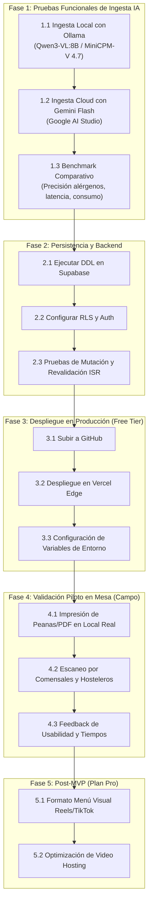

# Roadmap Detallado: Nexo MVP y Validación

> **Proyecto:** Nexo  
> **Estado:** MVP Construido (Fase 4 Completada)  
> **Fase Actual:** Validación, Pruebas de Ingesta IA y Despliegue

---

## 1. Visión General del Roadmap

---

## 2. Desglose Detallado de Hitos

### Hito 1: Ingesta IA en Local (Ollama) vs Cloud (Gemini)
* **Objetivo:** Probar el pipeline de visión de forma 100% privada y offline antes de conectar APIs externas.
* **Modelos Locales Evaluados (del setup de `LLM_Local_Setup`):**
  * `qwen3-vl:8B`: Modelo ligero (6,1 GB), excelente capacidad de OCR y visión tabular, respuesta ágil en Apple Silicon M1 Pro.
  * `openbmb/minicpm-v4.7:latest`: Modelo multimodal avanzado (22 GB), diseñado específicamente para lectura de documentos complejos.
* **Criterios de Aceptación:**
  * Endpoint local en `http://127.0.0.1:11434/api/chat` devuelve JSON estructurado según el schema.
  * Selector en `.env.local` (`AI_PROVIDER=local` vs `AI_PROVIDER=gemini`).
  * Precisión de alérgenos UE evaluada con al menos 3 fotos de cartas reales.

### Hito 2: Configuración de Base de Datos (Supabase)
* **Objetivo:** Pasar del modo demostración a persistencia multi-tenant real en PostgreSQL.
* **Entregables:**
  * Tablas `restaurants`, `categories`, `dishes` creadas mediante el script DDL.
  * Políticas de Row Level Security (RLS) verificadas: Comensales solo lectura pública, dueño solo escritura de sus platos.
  * Activación de revalidación atómica de tags ISR (`menu-[slug]`).

### Hito 3: Despliegue en Vercel (Producción 0 €)
* **Objetivo:** Tener la aplicación en vivo con SSL y subdominio público en internet.
* **Entregables:**
  * Repositorio conectado a Vercel CI/CD.
  * Variables de entorno de producción inyectadas (`NEXT_PUBLIC_SUPABASE_URL`, etc.).
  * Verificación de First Load JS < 150 kB y tiempo de respuesta < 500 ms en móvil.

### Hito 4: Prueba Piloto con Establecimiento Real
* **Objetivo:** Validar la propuesta de valor *"Tu restaurante en internet en 3 minutos"*.
* **Métricas a Medir:**
  * Tiempo total desde la foto hasta el QR impreso en mesa.
  * Tasa de correcciones necesarias en el editor táctil (< 10%).
  * Comprensión comensal de la barra de alérgenos sin asistencia.

### Hito 5: Fase 2 (Post-MVP - Menú Reels/TikTok)
* **Objetivo:** Añadir soporte de vídeo vertical corto para platos destacados en el Plan Pro (5 €/mes).
